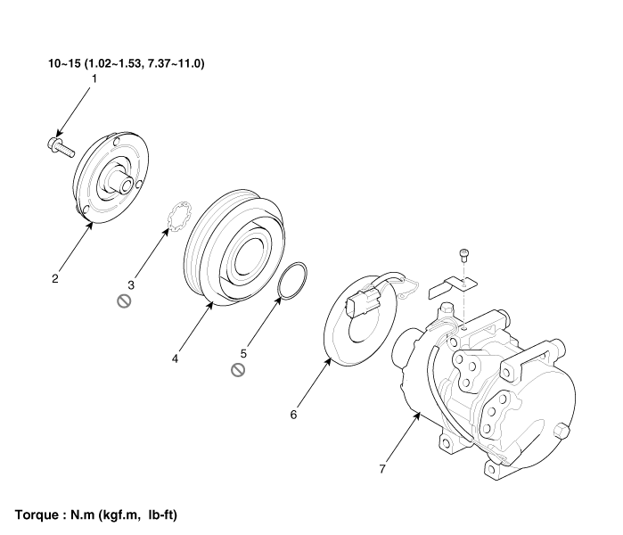

# Kia Sportage: Compressor: Componentes e Localização dos Componentes

[Home](../../index.md) / [Manual de Serviço e Reparo do Kia Sportage SL](../sportage-482.md) / [Aquecimento, Ventilação, Ar Condicionado](sportage-1181.md) / [Sistema de Ar Condicionado](sportage-1186.md) / Compressor: Componentes e Localização dos Componentes

## Componentes

| 1. Parafuso 2. Conjunto de Disco e Eixo 3. Anel de Manutenção (Polia) 4. Polia | 5. Anel de Manutenção (Coil de Campo) 6. Coil de Campo 7. Conjunto de Compressor |
