# Kia Sportage: Compressor: Procedimentos de Reparo

[Home](../../index.md) / [Manual de Serviço e Reparo do Kia Sportage SL](../sportage-482.md) / [Aquecimento, Ventilação, Ar Condicionado](sportage-1181.md) / [Sistema de Ar Condicionado](sportage-1186.md) / Procedimentos de Reparo do Compressor

## Remoção

1. Se o compressor estiver apenas operacional, deixe o motor rodar em velocidade de idle e deixe o ar condicionado funcionar por alguns minutos, depois desligue o motor.

2. Desconecte o cabo negativo da bateria.

3. Recupere o refrigerante com uma estação de recuperação/charging.

4. 4.	Desloque a correia de transmissão.

   (Consulte o grupo EM - "Correia de transmissão")

5. Desloque os parafusos de montagem e, em seguida, remova o cobre inferior (A).

   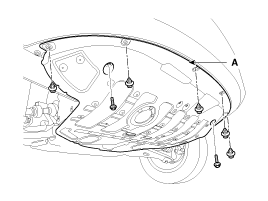

6. Remova os parafusos, depois desconecte a linha de sucção (A) e a linha de descarga (B) do compressor. Obstrua ou tampasse as linhas imediatamente após desconectá-las para evitar contaminação com umidade e poeira.

   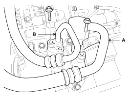

7. Desconecte o conector do interruptor do compressor, e então remova os parafusos de montagem e o compressor (B).

   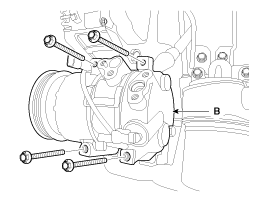

## Instalação

1. Verifique a largura dos parafusos de montagem do compressor, e então aperte-os na ordem A>B>C>D.

   ```
   Torque de aperto:
   20,0~32,9 N.m (2,04~3,36 kgf.m, 14,7~24,3 lb-ft)
   ```

   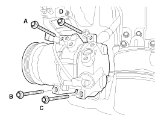

2. Instale na ordem inversa à remoção, e preste atenção a estes itens.

   | – | Se você estiver instalando um novo compressor, derrame todo o óleo de refrigeração do compressor removido, e mede seu volume. Subtraia o volume do óleo derramado do 120cc (4,20 oz.) e o resultado é a quantidade de óleo que você deve derramar do novo compressor (através da conexão de sucção). |
   | --- | --- |

   | – | Substitua as borrachas O-rings por novas, e aplique uma fina camada de óleo de refrigeração antes de instalá-las. Certifique-se de usar as borrachas O-rings corretas para R-134a para evitar vazamento. |
   | --- | --- |

   | – | Para evitar contaminação, não devolva o óleo à embalagem uma vez dispensado, e nunca misture com outros óleos de refrigeração. |
   | --- | --- |

   | – | Imediatamente após o uso do óleo, substitua a tampa na embalagem e selá-la para evitar a absorção de umidade. |
   | --- | --- |

   | – | Não derrame o óleo de refrigeração no veículo; ele pode danificar a pintura; se o óleo de refrigeração entrar em contato com a pintura, lave-o imediatamente. |
   | --- | --- |

   | – | Ajuste a correia de transmissão (Consulte HA-14) |
   | --- | --- |

   | – | Carregue o sistema e teste seu desempenho. |
   | --- | --- |

## Inspeção

Field Coil

[Operação]

1. Remova o compressor.

2. Verifique a operação do freio magnético. Conecte o terminal "3" do conector do compressor ao terminal do bateria (+) e o terminal do bateria (-) ao corpo do compressor. Verifique o som de operação do freio magnético para determinar o estado.

   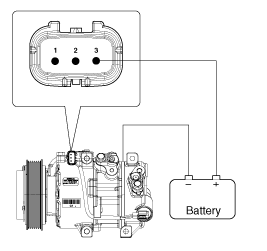

   | NÚMERO | Descrição | NÚMERO | Descrição |
   | --- | --- | --- | --- |
   | 1 | ECV (+) | 3 | Freio do A/C (+) |
   | 2 | ECV (-) | | |

[Resistência]

1. Desconecte o conector ECV do compressor.

2. Mede a resistência entre o corpo do compressor e o terminal "3" do conector ECV.

   ```
   Especificação de Resistência: 2,8 ~ 3,2?
   ```

   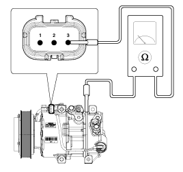

   > **Aviso**
   >
   > - A resistência do ECV pode ser ligeiramente maior ou menor que a especificação, dependendo da temperatura do ECV.

   > **Nota**
   >
   > - Tenha cuidado com o ECV com pinho torcido.
   > - Conecte e desconecte o conector com cuidado.

   > **Aviso**
   >
   > - Procedimento de verificação do Field Coil do compressor (Apenas tipo freio)

Inspeção do Compressor do Valvulador de Controle Elétrico (Tester)

1. Desconecte o conector ECV do compressor.

2. Mede a resistência entre os terminais "+" e "-" do conector ECV.

   ```
   Especificação de Resistência (@ 25°C / 77°F): 10,1~11,1?
   ```

   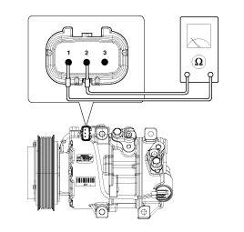

   | NÚMERO | Descrição | NÚMERO | Descrição |
   | --- | --- | --- | --- |
   | 1 | ECV (+) | 3 | Freio do A/C (+) |
   | 2 | ECV (-) | | |

   > **Aviso**
   >
   > - A resistência do ECV pode ser ligeiramente maior ou menor que a especificação, dependendo da temperatura do ECV.

   > **Nota**
   >
   > - Tenha cuidado com o ECV com pinho torcido.
   > - Conecte e desconecte o conector com cuidado.

## Desmontagem

1. Remova a roda da frente esquerda (A).

   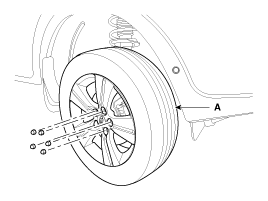

2. Desloque os parafusos de montagem e, em seguida, remova o cobertura inferior (A).

   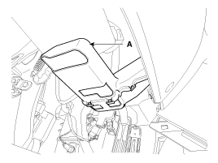

3. Remova a cobertura do lado do motor (A).

   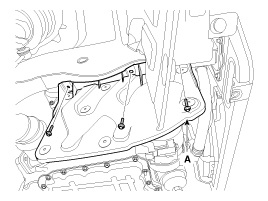

4. Remova a casa do pneu (A).

   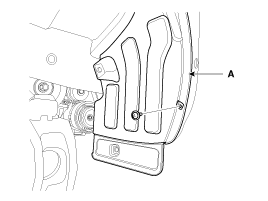

5. Remova o parafuso central (A), mantendo o conjunto disco e eixo com SST (09977-29000).

   ```
   Torque de aperto:
   10~15N.m (1,02~1,53kgf.m, 7,37~11lbf.ft)
   ```

   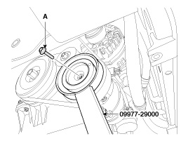

6. Remova o conjunto disco e eixo (A).

   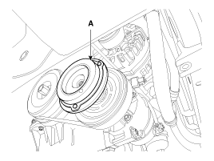

7. Desloque a corrente de distribuição.

   (Consulte o grupo EM - "Corrente de distribuição")

8. Desconecte o anel de retenção (A) e, em seguida, remova o rolamento (B).

   > **Nota**
   >
   > - Cuide para não danificar o rolamento (B) e compressor durante a remoção/instalação.
   > - Uma vez removido o anel de retenção (A), substitua-o por um novo.

   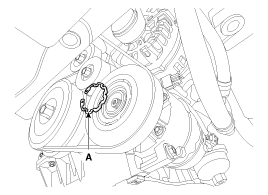

   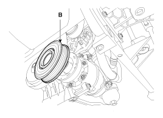

9. Remova o anel de retenção (B) e, em seguida, remova o bobina de campo (C). Cuide para não danificar a bobina e compressor.

   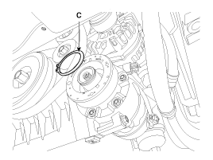

10. Para preparar o espaço de trabalho, desloque os parafusos de montagem do compressor.

11. Desconecte o conector e a viga de terra e, em seguida, remova a bobina de campo (A).

   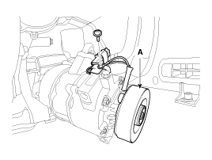

12. Reassemble o compressor clutch no sentido contrário à desmontagem, e note os seguintes itens:

   | – | Limpe as superfícies de rotação do rolamento e do compressor com solvente não-petrolífero. |
   | --- | --- |

   | – | Instale novos anéis de retenção e assegure-se de que eles estejam completamente instalados na viga. |
   | --- | --- |

   | – | Verifique que o rolamento gire suavemente após a reassembly. |
   | --- | --- |
