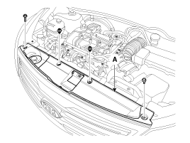
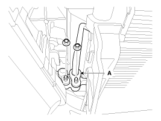
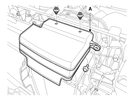
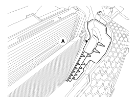
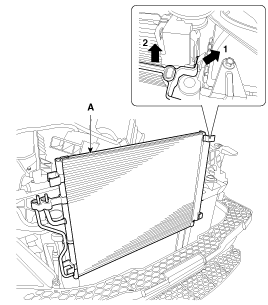

# Kia Sportage: Condensador: Procedimentos de Reparo

[Home](../../index.md) / [Manual de Serviço e Reparo do Kia Sportage SL](../sportage-482.md) / [Aquecimento, Ventilação, Ar Condicionado](sportage-1181.md) / [Sistema de Ar Condicionado](sportage-1186.md) / Procedimentos de Reparo do Condensador

## Inspeção

1. Verifique os fios do condensador para obstruções e danos. Se estiver obstruído, limpe-os com água e sopre-os com ar comprimido. Se estiver dobrado, retorne-os suavemente usando uma furadeira ou pinças.

2. Verifique as conexões do condensador para vazamento, e faça as correções ou substitua-as se necessário.

## Substituição

1. Recupere o refrigerante com uma estação de recuperação/reciclagem/charging.

2. Desconecte o terminal negativo (-) da bateria.

3. Remova a cobertura superior do bummper frontal (A).

   

4. Remova a linha de descarga e a linha líquida (A) do condensador.

   

5. Remova a cobertura do intercooler (A).

   

6. Remova a cobertura latera do condensador (A).

   

7. Remova o condensador (A) do radiador.

   

8. Instale em ordem inversa à remoção, e note os seguintes itens:

   | – | Se estiver instalando um novo condensador, adicione óleo de refrigerante ND-OIL8. |
   | --- | --- |

   | – | Substitua as borrachas O-rings por novas em cada conexão, e aplique uma fina camada de óleo de refrigerante antes de instalá-las. Certifique-se de usar as borrachas O-rings corretas para R-134a para evitar vazamentos. |
   | --- | --- |

   | – | Cuide para não danificar os fios do radiador e do condensador durante a instalação do condensador. |
   | --- | --- |

   | – | Certifique-se de instalar os amortecedores inferiores do condensador firmemente nos buracos. |
   | --- | --- |

   | – | Carregue o sistema e teste seu desempenho. |
   | --- | --- |
