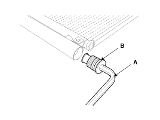
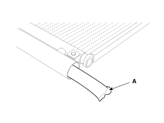

# Kia Sportage: Receiver-Drier: Procedimentos de Reparo

[Home](../../index.md) / [Manual de Serviço e Reparo do Kia Sportage SL](../sportage-482.md) / [Aquecimento, Ventilação, Ar Condicionado](sportage-1181.md) / [Sistema de Ar Condicionado](sportage-1186.md) / Procedimentos de Troca

## Troca

1. Remova o condensador, e então remova a tampa inferior (B) com chave de 12 (A) do condensador.

   ```
   Torque de aperto :
   20~25N.m (2.0~2.5kgf.m, 14.5~18.2lb-ft)
   ```

   

2. Remova o desumidificador (A) do condensador usando pinça de nariz longa. Verifique se há desumidificador quebrado e filtro da tampa inferior obstruído.

   

3. Aplicar óleo do compressor de ar condicionado nas gomas O-rings e nos fios do novo capô inferior.

4. Insira o novo desumidificador no tanque do receiver-drier. O
   desumidificador deve estar selado sob vácuo antes de ser exposto ao ar para uso.

5. Instale o novo capô inferior no condensador.

   > **Nota**
   >
   > - Sempre troque o desumidificador e o capô inferior ao mesmo tempo.
   > - Troque as gomas O-rings com novas em cada conexão, e aplique uma
    fina camada de óleo refrigerante antes de instalá-las. Certifique-se de usar as
    gomas O-rings corretas para R-134a para evitar vazamento.
   > - Cuide para não danificar as finas do radiador e do condensador ao instalar o condensador.
   > - Certifique-se de instalar as almofadas de montagem inferiores do condensador firmemente nos orifícios.
   > - Carregue o sistema, e teste seu desempenho.
