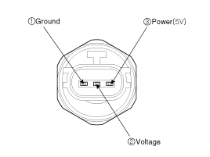
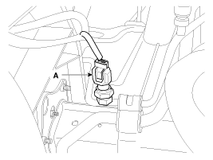
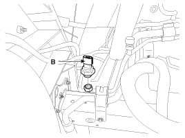

# Kia Sportage: Transdutor de Pressão do A/C: Procedimentos de Reparo

[Home](../../index.md) / [Manual de Serviço e Reparo do Kia Sportage SL](../sportage-482.md) / [Aquecimento, Ventilação, Condicionamento de Ar](sportage-1181.md) / [Sistema de Condicionamento de Ar](sportage-1186.md) / Transdutor de Pressão do A/C: Procedimentos de Reparo

## Inspeção

1. Medir a pressão da linha de alta pressão medindo a saída de voltagem entre os terminais NO.1 e NO.2.

   

2. Inspecionar o valor de voltagem para verificar se é suficiente para ser o valor regular.

   ```
   Voltagem = 0.00878835 * Pressão + 0.37081095 [PSIA]
   ```

3. Se o valor de voltagem medido não estiver de acordo com a especificação, substituir o transdutor de pressão do A/C.

## Substituição

1. Desconectar o terminal negativo (-) da bateria.

2. Recuperar o refrigerante com uma estações de recuperação/charging.

3. Desconectar o conectador do transdutor de pressão do A/C (3P) (A).

   ```
   Torque de aperto:
   10~12 N.m (1.0~1.2 kgf.m, 7.4~8.8 lb-ft)
   ```

   

   

   > **Cuidado**
   >
   > - Cuide para que os tubos líquido e de sucção não sejam dobrados.

4. A instalação é o contrário do desmonte.
