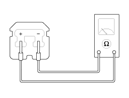
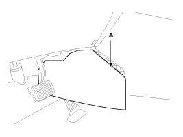
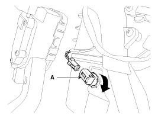

# Kia Sportage: Sensor de Temperatura do Evaporador: Procedimentos de Reparo

[Home](../../index.md) / [Manual de Serviço e Reparo do Kia Sportage SL](../sportage-482.md) / [Aquecimento, Ventilação, Ar Condicionado](sportage-1181.md) / [Sistema de Ar Condicionado](sportage-1186.md) / Procedimentos de Reparo do Sensor de Temperatura do Evaporador

## Inspeção

1. Desligue a ignição "OFF".

2. Desconecte o sensor de temperatura do evaporador.

3. Usando o multímetro, mede a resistência entre os terminais "1" e "2" do sensor de temperatura do evaporador.

   

   Especificação

   | Temperatura do núcleo de evaporador [°C(°F)] | Resistência [K?] | Tensão [V] |
   | --- | --- | --- |
   | -10(14) | 17.93 | 3.22 ± 0.5 |
   | -5(23) | 14.22 | 2.94 ± 0.5 |
   | 0(32) | 11.36 | 2.67 ± 0.5 |
   | 5(41) | 9.14 | 2.39 ± 0.5 |
   | 10(50) | 7.40 | 2.13 ± 0.5 |
   | 15(59) | 6.02 | 1.88 ± 0.5 |
   | 20(68) | 4.94 | 1.66 ± 0.5 |
   | 25(77) | 4.066 | 1.45 ± 0.5 |
   | 30(86) | 3.369 | 1.26 ± 0.5 |
   | 35(95) | 2.85 | 1.1 ± 0.5 |
   | 40(104) | 2.348 | 0.95 ± 0.5 |
   | 45(113) | 1.975 | 0.83 ± 0.5 |
   | 50(122) | 1.668 | 0.72 ± 0.5 |

## Substituição

1. Remova a capa do console (A).

   

2. Remova o sensor de temperatura do evaporador (A), puxando-o após girá-lo 90° no sentido horário.

   

3. A instalação é o contrário do processo de remoção.
