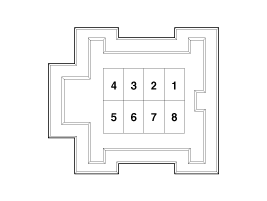
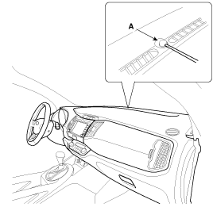

# Kia Sportage: Sensor Fotográfico: Procedimentos de Reparo

[Home](../../index.md) / [Manual de Serviço e Reparo do Kia Sportage SL](../sportage-482.md) / [Aquecimento, Ventilação, Ar Condicionado](sportage-1181.md) / [Sistema de Ar Condicionado](sportage-1186.md) / Procedimentos de Reparo do Sensor Fotográfico

## Inspeção

1. Ignição "LIGADO"

2. Usando a ferramenta de escaneamento.

3. Emita luz intensa para o sensor fotográfico usando uma lâmpada e verifique o mudança na tensão de saída.

4. A tensão aumentará com luz intensa maior e diminuirá com luz intensa menor.

   

   | 1. Sensor de Terra 2. Sinal do Sensor Fotográfico 3. - 4. - | 5. - 6. DR Sensor Fotográfico (-) 7. PA Sensor Fotográfico (-) 8. 5V (Vcc) |
   | --- | --- |

## Troca

1. Desconecte o terminal negativo (-) da bateria.

2. Com o driver (-), remova o sensor fotográfico (A) do centro do orifício do desumidificador.

   

3. Instale na ordem inversa à remoção.
