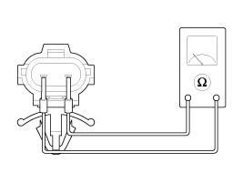
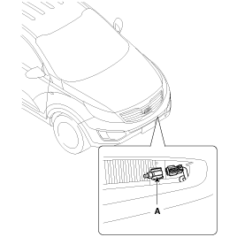

# Kia Sportage: Sensor Ambient: Procedimentos de Reparo

[Home](../../index.md) / [Manual de Serviço e Reparo do Kia Sportage SL](../sportage-482.md) / [Aquecimento, Ventilação, Ar Condicionado](sportage-1181.md) / [Sistema de Ar Condicionado](sportage-1186.md) / Procedimentos de Reparo do Sensor Ambiental

## Inspeção

1. Desligue a ignição "OFF"

2. Desconecte o sensor de temperatura ambiente.

3. Verifique a resistência do sensor de temperatura ambiente entre
   os terminais 1 e 2, verificando se há alteração na resistência com
   variação da temperatura ambiente.

   

   | 1. Sensor de Terra | 2. Sensores de Temperatura Ambiente |
   | --- | --- |

   Especificação

   | Temperatura Ambiente [°C(°F)] | Resistência entre os terminais 1 e 2 (k?) |
   | --- | --- |
   | -30(-22) | 507 |
   | -20(-4) | 284,5 |
   | -10(14) | 164,2 |
   | 0 (32) | 97,5 |
   | 10 (50) | 59,6 |
   | 20 (68) | 37,46 |
   | 30(86) | 24,18 |
   | 40(104) | 16 |
   | 50(122) | 10,83 |

4. Se a resistência medida não estiver de acordo com a especificação, substitua o sensor de temperatura ambiente com um sensor conhecido como bom e verifique a operação correta.

5. Se o problema for corrigido, substitua o sensor de temperatura ambiente.

## Substituição

1. Desconecte o terminal negativo (-) da bateria.

2. Desconecte o conectador e, em seguida, remova o sensor de temperatura ambiente (A).

   

3. A instalação deve ser feita na ordem inversa à remoção.
