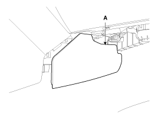
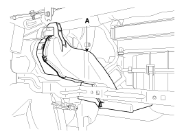
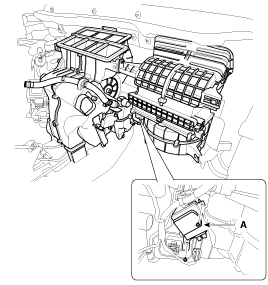

# Kia Sportage: Ionizador de cluster: Procedimentos de reparo

[Home](../../index.md) / [Manual de Serviço e Reparo do Kia Sportage SL](../sportage-482.md) / [Aquecimento, Ventilação, Ar Condicionado](sportage-1181.md) / [Sistema de Ar Condicionado](sportage-1186.md) / Ionizador de cluster: Procedimentos de reparo

## Inspeção

1. Pressione o botão OFF mais de 4 vezes em 2 segundos enquanto segurando o botão MODE.

   | Exibição | Descrição de falha |
   | --- | --- |
   | 00 | Normal |
   | 50 | Falha no ionizador de cluster |

   * O procedimento de diagnóstico se refere ao código de falha DTC.

## Troca

1. Desconecte o terminal negativo (-) da bateria.

2. Remova a capa de expansão (A).

   

3. Remova o dutos do chuveiro (A).

   

4. Aos solte os parafusos e, em seguida, remova o ionizador de cluster (A).

   

5. A instalação é o contrário do processo de remoção.
