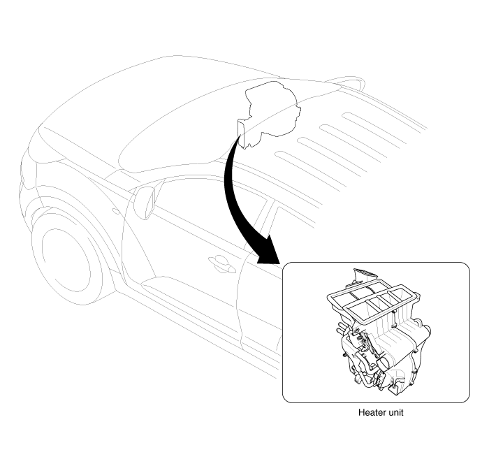
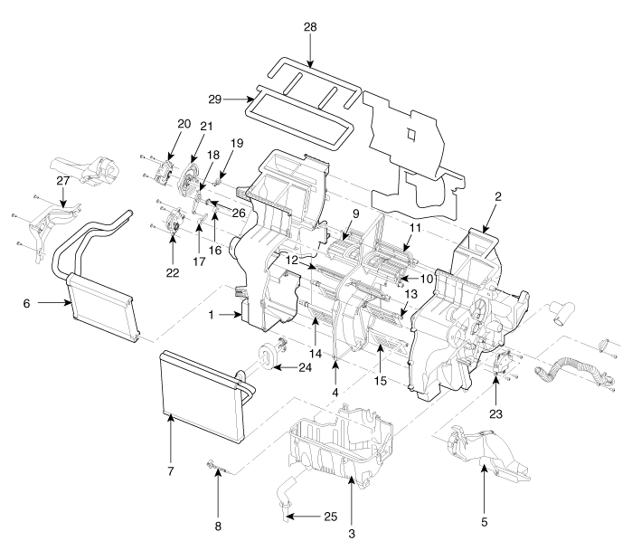

# Unidade de Aquecimento — Componentes e localização

[Home](../../index.md) / [Manual de Serviço e Reparo](../sportage-482.md) / [Aquecimento, Ventilação, Ar Condicionado](sportage-1181.md) / [Unidade de Aquecimento](sportage-1211.md) / Componentes e localização

## Diagrama — Localização

## Diagrama — Componentes

## Legenda — Componentes

| Nº | Componente |
| --- | --- |
| 1 | Caixa de Aquecimento (LH) |
| 2 | Caixa de Aquecimento (RH) |
| 3 | Caixa de Aquecimento Inferior |
| 4 | Separador |
| 5 | Ducto de Ducha |
| 6 | Core de Aquecimento |
| 7 | Core de Evaporador |
| 8 | Sensor de Evaporador |
| 9 | Porta de Ventilação |
| 10 | Porta de Ventilação |
| 11 | Porta de Defensão |
| 12 | Porta dos Pés |
| 13 | Porta de Controle de Temperatura |
| 14 | Porta de Controle de Temperatura |
| 15 | Porta de Controle de Temperatura |
| 16 | Braço da Porta de Ventilação |
| 17 | Cinto do Pés |
| 18 | Braço da Porta dos Pés |
| 19 | Cinto da Defensão |
| 20 | Atuador de Controle de Modo |
| 21 | Câmbio de Modo |
| 22 | Atuador de Controle de Temperatura (apenas Controle de Clima Duplo) |
| 23 | Atuador de Controle de Temperatura |
| 24 | Flange Seal |
| 25 | Hidrante de Descarga |
| 26 | Mola do Lava-vidros |
| 27 | Cobertura do Core de Aquecimento |
| 28 | Flange Seal |
| 29 | Flange Seal |
