# Kia Sportage: Unidade de Aquecimento: Procedimentos de Reparo

[Home](../../index.md) / [Manual de Serviço e Reparo do Kia Sportage SL](../sportage-482.md) / [Aquecimento, Ventilação, Condicionamento de Ar](sportage-1181.md) / [Aquecimento](sportage-1211.md) / Procedimentos de Reparo da Unidade de Aquecimento

## Troca

1. Desconecte o terminal negativo (-) da bateria.

2. Recupere o refrigerante com uma estações de recuperação/reciclagem/charger.

3. Quando o motor estiver frio, derrame o líquido de arrefecimento do radiador.

4. Remova a cobertura do valve expansor (A).

   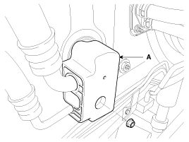

5. Remova as varetas (A) e o valve expansor (B) do núcleo evaporador.

   ```
   Torque de apertar :
   7,8 ~ 11,7 N.m ( 0,8 ~ 1,2 kgf.m, 5,7 ~ 8,6 lb-ft)
   ```

   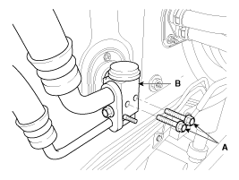

   > **Cuidado**
   >
   > - Plug ou tampar as linhas imediatamente após desconectá-las para evitar contaminação com umidade e poeira.

6. Remova a junta do valve expansor (A).

   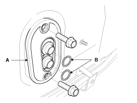

7. Desconecte as mangueiras de entrada (C) e saída (D) do aquecedor do motor do seu ponto de conexão.

   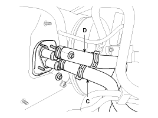

   > **Cuidado**
   >
   > - O líquido de arrefecimento irá escorrer quando as mangueiras forem desconectadas;
   derrame-o em um recipiente limpo. Certifique-se de não deixar o líquido escorrer sobre
   partes elétricas ou superfícies pintadas. Se algum líquido escorrer, lave-o imediatamente.

8. Remova a capota do cowl.

   (Consulte o grupo BD - "Capota do Cowl").

9. Aos solte as varetas de fixação do cowl cross member (A).

   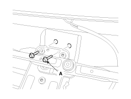

10. Remova o volante e a coluna do volante.

    (Consulte o grupo ST - "Coluna do Volante").

11. Remova o console central.

    (Consulte o grupo BD - "Console Central").

12. Desconecte o conector do airbag (A).

    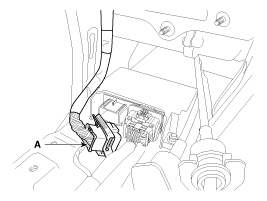

13. Desconecte os conectores e remova o multi box esquerdo e direito (A).

    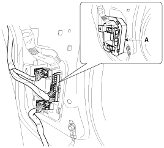

    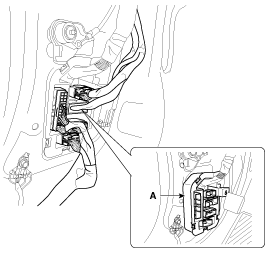

14. Remova o trim esquerdo e direito do tanque e, em seguida, desconecte o conector (A).

    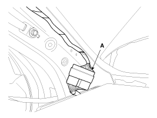

    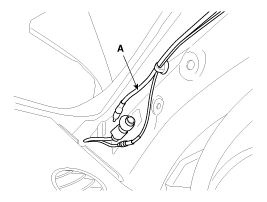

15. Desloque as varetas de fixação do unitário aquecedor e, em seguida, remova o unitário aquecedor e o blower (A).

    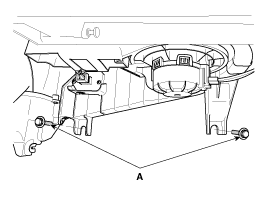

16. Aos solte as varetas de fixação do cowl cross member (A) e, em seguida, remova a capa de impacto e o unitário aquecedor e blower.

    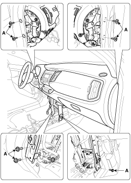

17. Desconecte os conectores e, em seguida, remova o unitário aquecedor e blower (A) da capa de impacto.

    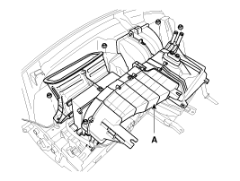

18. Desloque as varetas de fixação e, em seguida, remova o unitário blower (A) do unitário aquecedor (B).

    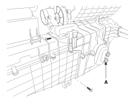

    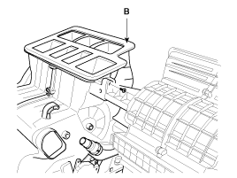

19. Aos solte a vareta de fixação e, em seguida, remova a capa do evaporador (A).

    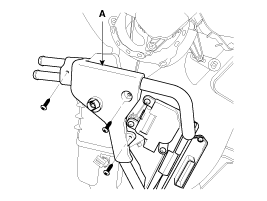

20. Desconecte o unitário aquecedor (A) do unitário aquecedor.

    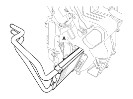

21. Aos solte a vareta de fixação do unitário aquecedor inferior e, em seguida, remova o unitário aquecedor inferior (A).

    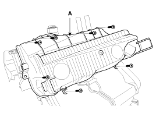

22. Remova o núcleo evaporador (A).

    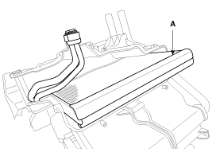

23. Cuide para que as mangueiras de entrada e saída não sejam dobradas durante a remoção do unitário aquecedor, e tire o unitário aquecedor.

24. A instalação é o contrário da remoção.

25. A instalação deve ser feita no sentido inverso à remoção, e preste atenção a estes itens:

   | – | Se estiver instalando um novo evaporador, adicione óleo refrigerante (ND-OIL8). |
   | --- | --- |

   | – | Substitua as borrachas O-rings por novas em cada conexão, aplicando uma fina camada de óleo refrigerante antes de instalá-las. Certifique-se de usar as borrachas O-rings corretas para R-134a para evitar vazamentos. |
   | --- | --- |

   | – | Imediatamente após o uso do óleo, substitua a tampa do recipiente e o feche para evitar a absorção de umidade. |
   | --- | --- |

   | – | Não derrame o óleo refrigerante no veículo; ele pode danificar a pintura; se o óleo refrigerante entrar em contato com a pintura, lave-o imediatamente. |
   | --- | --- |

   | – | Aplicar selante nos grommets. |
   | --- | --- |

   | – | Certifique-se de que não haja vazamento de ar. |
   | --- | --- |

   | – | Carregue o sistema e teste seu desempenho. |
   | --- | --- |

   | – | Não intercambie as mangueiras de entrada e saída do aquecedor e instale as tampa de mangueira seguramente. |
   | --- | --- |

   | – | Preencha o sistema de resfriamento com líquido de refrigeração do motor. |
   | --- | --- |
