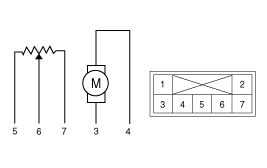
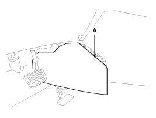
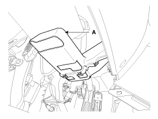
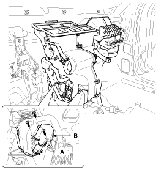
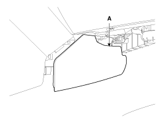
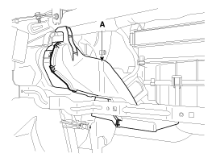
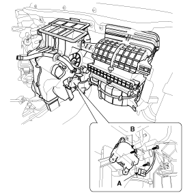

# Kia Sportage: Atuador de Controle de Temperatura: Procedimentos de Reparo

[Home](../../index.md) / [Manual de Serviço e Reparo do Kia Sportage SL](../sportage-482.md) / [Aquecimento, Ventilação, Ar Condicionado](sportage-1181.md) / [Aquecedor](sportage-1211.md) / Procedimentos de Reparo do Atuador de Controle de Temperatura

## Inspeção

1. Desligamento da ignição "OFF"

2. Desconecte o conectador do atuador de controle de temperatura.

3. Verifique se o atuador de controle de temperatura opera para a posição quente quando se conectar 12V ao terminal 3 e ao terminal 4 conectado ao chão.

   Verifique se o atuador de controle de temperatura opera para a posição fria quando se conectar na ordem inversa.

   [Dirigir]

   

   | 1. - 2. - 3. Posição quente 4. Posição fria | 5. Sensor de chão 6. Sinal de retorno 7. 5V (Vcc) |
   | --- | --- |

4. Verifique a tensão entre os terminais 5 e 6(Dirigir).

   Especificação

   | Posição da porta | Tensão(5-6) | Detecção de erro |
   | --- | --- | --- |
   | Máx. resfriamento | 0,4 ± 0,15V | Baixa tensão: 0,1V ou menos |
   | Máx. aquecimento | 4,6 ± 0,15V | Alta tensão: 4,9V ou mais |

   [Passageiro]

   

   | 1. - 2. - 3. Posição fria 4. Posição quente | 5. 5V (Vcc) 6. Sinal de retorno 7. Sensor de chão |
   | --- | --- |

5. Verifique a tensão entre os terminais 6 e 7(Passageiro).

   Especificação

   | Posição da porta | Tensão(6-7) | Detecção de erro |
   | --- | --- | --- |
   | Máx. resfriamento | 0,4 ± 0,15V | Baixa tensão: 0,1V ou menos |
   | Máx. aquecimento | 4,6 ± 0,15V | Alta tensão: 4,9V ou mais |

   Ele fornecerá o posicionamento atual do atuador para os controles.

6. Se a tensão medida não estiver dentro da especificação, substitua o atuador de controle de temperatura com um conhecido bom e verifique a operação correta.

7. Se o problema for corrigido, substitua o atuador de controle de temperatura.

## Substituição

1. Desconecte o terminal negativo (-) da bateria.

2. Remova a capa de extensão esquerda (A).

   

3. Remova o dutos de chuveiro esquerdo (A).

   

4. Desconecte o conectador do atuador de controle de temperatura (A).

5. Ajuste o parafuso de montagem e, em seguida, remova o atuador de controle de temperatura (B).

   

6. Remova a capa de extensão direita (A).

   

7. Remova a placa de impacto principal.

   (Consulte o grupo BD - "Placa de Impacto")

8. Remova o dutos de chuveiro direito (A).

   

9. Desconecte o conectador do atuador de controle de temperatura (A).

10. Ajuste o parafuso de montagem e, em seguida, remova o atuador de controle de temperatura (B).

    

11. A instalação será na ordem inversa da remoção.
