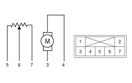
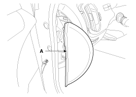
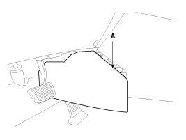
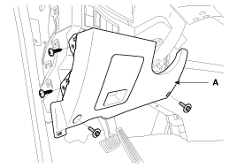
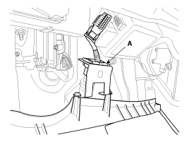
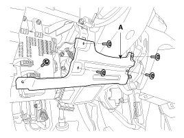
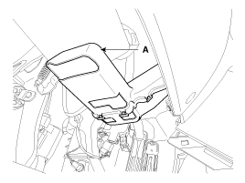
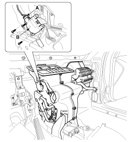

# Kia Sportage: Atuador de Controle de Modo: Procedimentos de Reparo

[Home](../../index.md) / [Manual de Serviço e Reparo do Kia Sportage SL](../sportage-482.md) / [Aquecimento, Ventilação, Ar Condicionado](sportage-1181.md) / [Aquecedor](sportage-1211.md) / Procedimentos de Reparo do Atuador de Controle de Modo

## Inspeção

1. Ignição "OFF”

2. Desconecte o conector do atuador de controle de modo.

3. Verifique se o atuador de controle de modo opera no modo desentorpecimento quando fornece 12V ao terminal 3 e conecta o terminal 4 a massa.

4. Verifique se o atuador de controle de modo opera no modo de ventilação quando fornece a inversão.

   

   | 1. - 2. - 3. Modo desentorpecimento 4. Modo de ventilação | 5. Sensores de massa 6. Sinal de retorno 7. 5V(Vcc) |
   | --- | --- |

5. Verifique a tensão entre os terminais 5 e 6.

   | Posição da porta | Tensão (5-6) | Erro de detecção |
   | --- | --- | --- |
   | Ventilação | 0,4 ± 0,15V | Baixa tensão : 0,1V ou menos |
   | Desentorpecimento | 4,6 ± 0,15V | Alta tensão : 4,9V ou mais |

   Ele retornará a posição atual do atuador para os controles.

6. Se a tensão medida não estiver dentro da especificação, substitua pelo atuador de controle de modo conhecido e verifique se opera corretamente.

7. Se o problema for corrigido, substitua o atuador de controle de modo.

## Substituição

1. Desconecte o terminal negativo (-) da bateria.

2. Remova a capa de proteção do lado esquerdo do crash pad (A).

   

3. Remova a capa de extensão do lado esquerdo (A).

   

4. Remova a capa de proteção do crash pad inferior (A).

   

5. Desconecte o conector de diagnóstico (A).

   

6. Remova a placa de reforço (A).

   

7. Remova o dutos do chuveiro do lado esquerdo (A).

   

8. Remova o BCM.

   (Consulte o grupo BE - "BCM")

9. Desconecte o conector do atuador de controle de modo (A).

10. Desloque o parafuso de montagem e, em seguida, remova o atuador de controle de modo (B).

    

11. A instalação é o contrário do procedimento de remoção.
