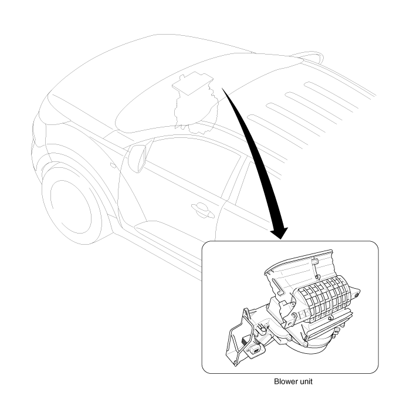

# Unidade de Ventilador — Componentes e localização

[Home](../../index.md) / [Manual de Serviço e Reparo](../sportage-482.md) / [Aquecimento, Ventilação, Condicionamento de Ar](sportage-1181.md) / [Ventilador](sportage-1220.md) / Componentes e localização

## Diagrama — Localização

## Diagrama — Componentes

## Legenda — Componentes

| Nº | Componente |
| --- | --- |
| 1 | Caixa de entrada (LH) |
| 2 | Caixa de entrada (RH) |
| 3 | Motor de ventilar |
| 4 | Porta de entrada |
| 5 | Atuador de porta de entrada |
| 6 | Mofet [Tipo automático] |
| 7 | Resistor [Tipo manual] |
| 8 | Cobertura do filtro de ar do controle climático |
| 9 | Filtro de ar do controle climático |
| 10 | Ionizador |
| 11 | Caixa de ventilar (Superior) |
| 12 | Caixa de ventilar (Inferior) |
| 13 | Selo de entrada |
