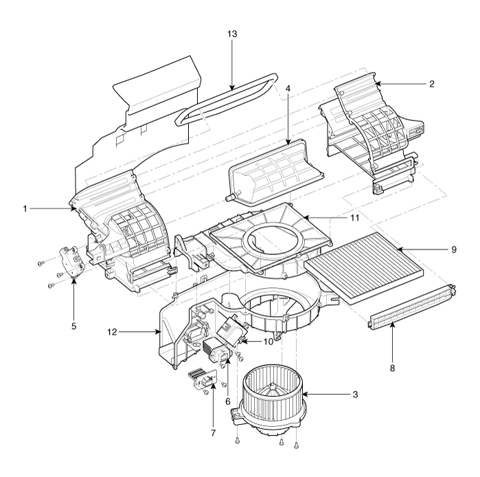

# Kia Sportage: Unidade de Ventilador: Componentes e Localização dos Componentes

[Home](../../index.md) / [Manual de Serviço e Reparo do Kia Sportage SL](../sportage-482.md) / [Aquecimento, Ventilação, Condicionamento de Ar](sportage-1181.md) / [Ventilador](sportage-1220.md) / Unidade de Ventilador: Componentes e Localização dos Componentes

## Localização dos Componentes

## Componentes

| 1. Caixa de entrada (LH) 2. Caixa de entrada (RH) 3. Motor de ventilar 4. Porta de entrada 5. Atuador de porta de entrada | 6. Mofet [Tipo automático] 7. Resistor [Tipo manual] 8. Cobertura do filtro de ar do controle climático 9. Filtro de ar do controle climático 10. Ionizador | 11. Caixa de ventilar (Superior) 12. Caixa de ventilar (Inferior) 13. Selo de entrada |
| --- | --- | --- |
