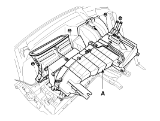
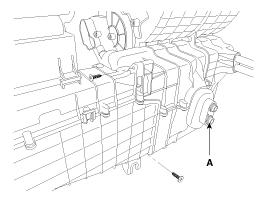
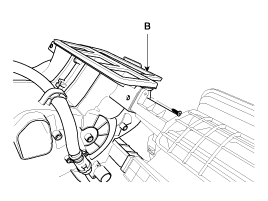

# Kia Sportage: Unidade de Ventilador: Procedimentos de Reparo

[Home](../../index.md) / [Manual de Serviço e Reparo do Kia Sportage SL](../sportage-482.md) / [Aquecimento, Ventilação, Condicionamento de Ar](sportage-1181.md) / [Ventilador](sportage-1220.md) / Procedimentos de Troca da Unidade de Ventilador

## Troca

1. Desconecte o terminal negativo (-) da bateria.

2. Remova o crash pad e a unidade de ventilador do aquecimento.

   (Consulte o grupo HA - "Unidade de Aquecimento")

3. Remova a unidade de ventilador (A) do crash pad.

   

4. Remova a unidade de ventilador (A) da unidade de aquecimento (B) após soltar uma porção do parafuso de montagem.

   

   

   > **Observação**
   >
   > - Certifique-se de que não há vazamento de ar nas juntas do ventilador e do tubo.

5. A instalação é o contrário do procedimento de remoção.
