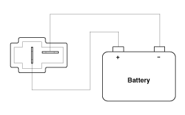
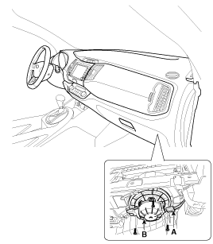

# Kia Sportage: Motor de Ventoinha: Procedimentos de Reparo

[Home](../../index.md) / [Manual de Serviço e Reparo do Kia Sportage SL](../sportage-482.md) / [Aquecimento, Ventilação, Condicionamento de Ar](sportage-1181.md) / [Ventoinha](sportage-1220.md) / Procedimentos de Reparo do Motor de Ventoinha

## Inspeção

1. Conecte a tensão da bateria e verifique a rotação do motor de ventoinha.

   

2. Se o motor de ventoinha não estiver funcionando quando a tensão é aplicada, substitua por um motor de ventoinha conhecido como bom e verifique se está funcionando corretamente.

3. Se o problema for corrigido, substitua o motor de ventoinha.

## Substituição

1. Desconecte o terminal negativo (-) da bateria.

2. Desconecte o conectador (A) do motor de ventoinha.

3. Remova o motor de ventoinha (B) após soltar as engrenagens de montagem.

   

4. A instalação é o contrário do processo de remoção.
