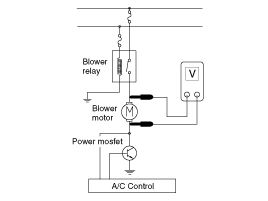
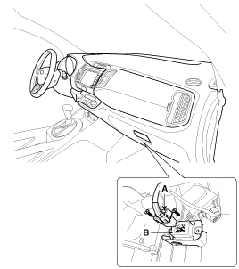

# Kia Sportage: Mosfet de Poder: Procedimentos de Reparo

[Home](../../index.md) / [Manual de Serviço e Reparo do Kia Sportage SL](../sportage-482.md) / [Aquecimento, Ventilação, Condicionamento de Ar](sportage-1181.md) / [Blower](sportage-1220.md) / Procedimentos de Reparo do Mosfet de Poder

## Inspeção

1. Ignição "ON"

2. Operar manualmente o interruptor de controle e medir a tensão do motor ventilador.

3. Selecionar o interruptor de controle para aumentar a tensão até a velocidade alta.

   

   Especificação

   | Fan | Tensão do Motor |
   | --- | --- |
   | Manual | |
   | Primeira velocidade | 4,0 ± 0,5V |
   | Segunda velocidade | 5,1 ± 0,5V |
   | Terceira velocidade | 6,2 ± 0,5V |
   | Quarta velocidade | 7,4 ± 0,5V |
   | Quinta velocidade | 8,6 ± 0,5V |
   | Sexta velocidade | 9,7 ± 0,5V |
   | Sétima velocidade | 10,8 ± 0,5V |
   | Oitava velocidade | Bateria |

   *AUTO COOLING : Velocidade automática (4,5V~B+)

   *AUTO HEATING : Velocidade automática (4,5V~11,0V)

4. Se a tensão medida não estiver dentro da especificação, substitua o mosfet de poder com um conhecido bom e verifique a operação correta.

5. Se o problema for corrigido, substitua o mosfet de poder.

## Substituição

1. Desconecte o terminal negativo (-) da bateria.

2. Desconecte o conectador do mosfet de poder (A) e, em seguida, remova o mosfet de poder (B) após soltar as varetas de fixação.

   

3. A instalação é o contrário do procedimento de remoção.
