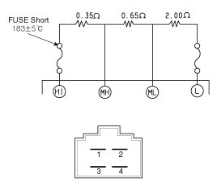
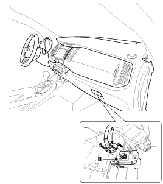

# Kia Sportage: Resistor de Ventoinha: Procedimentos de Reparo

[Home](../../index.md) / [Manual de Serviço e Reparo do Kia Sportage SL](../sportage-482.md) / [Aquecimento, Ventilação, Ar Condicionado](sportage-1181.md) / [Ventoinha](sportage-1220.md) / Procedimentos de Reparo do Resistor de Ventoinha

## Inspeção

1. Medir a resistência terminal-a-terminal do resistor de ventoinha.

2. Se a resistência medida não estiver dentro da especificação, o resistor de ventoinha deve ser substituído. (Depois de remover o resistor)

   

   | 1. ML 2. MH | 3. LO 4. HI |
   | --- | --- |

## Substituição

1. Desconectar o terminal negativo (-) da bateria.

2. Desconectar o conectador do resistor de ventoinha (A) e, em seguida, remover o resistor de ventoinha (B) após soltar as varetas de fixação.

   

3. A instalação deve ser feita na ordem inversa à remoção.
