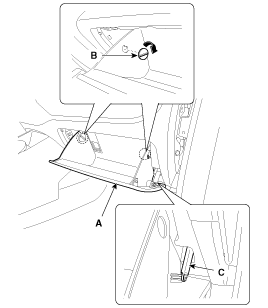
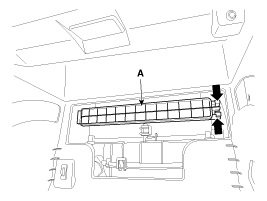
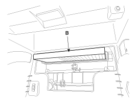

# Kia Sportage: Filtro de Ar do Controle Climático: Procedimentos de Reparo

[Home](../../index.md) / [Manual de Serviço e Reparo do Kia Sportage SL](../sportage-482.md) / [Aquecimento, Ventilação, Condicionamento de Ar](sportage-1181.md) / [Blower](sportage-1220.md) / Filtro de Ar do Controle Climático: Procedimentos de Reparo

## Troca

1. Desconecte o damper (B) e o elevador do box-glove (C) do box-glove (A).

   

2. Remova a capa do filtro empurrando o botão.

   

3. Substitua o filtro de ar (B), instale após garantir a direção do filtro de ar.

   

   > **Nota**
   >
   > - Em caso de condução em área poluída ou terreno acidentado, verifique e substitua o filtro de ar com frequência.

4. A instalação é o contrário do processo de remoção.
