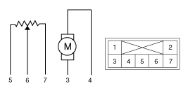
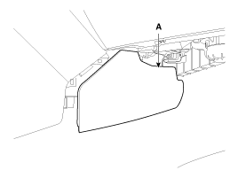
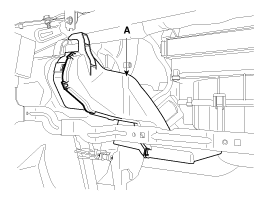
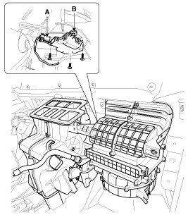

# Kia Sportage: Atuador de Admissão: Procedimentos de Reparo

[Home](../../index.md) / [Manuais de Serviço e Reparo do Kia Sportage SL](../sportage-482.md) / [Aquecimento, Ventilação, Condicionamento de Ar](sportage-1181.md) / [Ventoinha](sportage-1220.md) / Procedimentos de Reparo do Atuador de Admissão

## Inspeção

1. Desligue a ignição "OFF"

2. Desconecte o conector do atuador de admissão.

3. Verifique se o atuador opera para a posição de recirculação quando se conecta 12V ao terminal 3 e se grounda o terminal 4.

4. Verifique se o atuador de admissão opera para a posição de ar fresco quando se conecta na ordem inversa.

   

   | 1. - 2. - 3. Ar fresco 4. Recirculação | 5. 5V (Vcc) 6. Sinal de Retorno 7. Sensor Ground |
   | --- | --- |

5. Verifique a tensão entre os terminais 6 e 7.

   | Posição da porta | Tensão(6-7) | Erro detectado |
   | --- | --- | --- |
   | Ar fresco | 0,4 ± 0,15V | Baixa tensão : 0,1V ou menos |
   | Recirculação | 4,6 ± 0,15V | Alta tensão : 4,9V ou mais |

6. Se o atuador de admissão não operar corretamente, substitua por um atuador de admissão conhecido e verifique a operação correta.

7. Se o problema for corrigido, substitua o atuador de admissão.

## Substituição

1. Desconecte o terminal negativo (-) da bateria.

2. Remova a capa de extensão direita (A).

   

3. Remova o amortecedor de impacto.

   (Consulte o grupo BD - "Amortecedor de Impacto")

4. Remova o dutos de ducha direita (A).

   

5. Desconecte o conector do atuador de admissão (A).

6. Ajuste o parafuso de montagem e, em seguida, remova o atuador de admissão (B).

   

7. A instalação é o contrário do procedimento de remoção.
