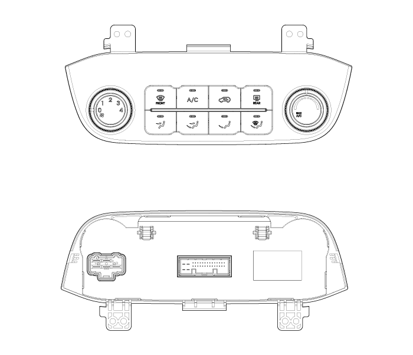

# Kia Sportage: Unidade de Controle do Aquecedor e do Ar-Condicionado (Manual): Componentes e Localização dos Componentes

[Home](../../index.md) / [Manual de Serviço e Reparo do Kia Sportage SL](../sportage-482.md) / [Aquecimento, Ventilação, Ar-Condicionado](sportage-1181.md) / [Controlador](sportage-1231.md) / Unidade de Controle do Aquecedor e do Ar-Condicionado (Manual): Componentes e Localização dos Componentes

## Componentes

Função do Pin do Conector

| Conector | Número de Pin | Função | Conector | Número de Pin | Função |
| --- | --- | --- | --- | --- | --- |
| Conector(A) | 1 | Alta | Conector(B) | 1 | Luz de Carga (ILL+) |
| 2 | Média Alta | 2 | Bateria |  |  |
| 3 | Média Baixa | 3 | Atuador de Modo (VENT) |  |  |
| 4 | - | 4 | Atuador de Modo (DEF) |  |  |
| 5 | GND | 5 | Atuador de Temperatura (COOL) |  |  |
| 6 | Baixa | 6 | Atuador de Temperatura (WARM) |  |  |
|  | 7 | Atuador de Interação (FRE) |  |  |  |
| 8 | Atuador de Interação (REC) |  |  |  |  |
| 9 | - |  |  |  |  |
| 10 | Detent |  |  |  |  |
| 11 | Atuador de Modo (F/B) |  |  |  |  |
| 12 | Atuador de Temperatura (F/B) |  |  |  |  |
| 13 | Atuador de Interação (F/B) |  |  |  |  |
| 14 | Motor de Ventoinha Comum (-) |  |  |  |  |
| 15 | F/B do Motor de Ventoinha |  |  |  |  |
| 16 | Rheostato (ILL-) |  |  |  |  |
| 17 | IG2 |  |  |  |  |
| 18 | IG1 |  |  |  |  |
| 19 | Can (ALTA) |  |  |  |  |
| 20 | Can (BAIXA) |  |  |  |  |
| 21 | HTD (Indicador de DEF Traseiro) |  |  |  |  |
| 22 | ECV IN |  |  |  |  |
| 23 | ECV OUT |  |  |  |  |
| 24 | - |  |  |  |  |
| 25 | Vref (+5V) |  |  |  |  |
| 26 | Sensor de Evaporador |  |  |  |  |
| 27 | Sensor de Ambiente |  |  |  |  |
| 28 | - |  |  |  |  |
| 29 | - |  |  |  |  |
| 30 | - |  |  |  |  |
| 31 | Sensor GND |  |  |  |  |
| 32 | GND |  |  |  |  |
