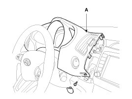
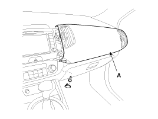
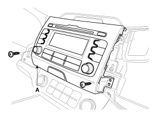
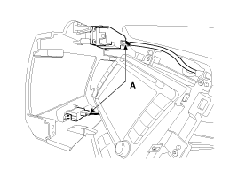
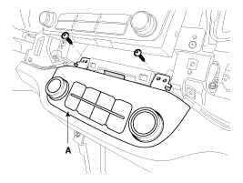
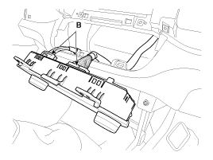

# Kia Sportage: Unidade de Controle do Aquecimento e do Ar-Condicionado (Manual): Procedimentos de Reparo

[Home](../../index.md) / [Manual de Serviço e Reparo do Kia Sportage SL](../sportage-482.md) / [Aquecimento, Ventilação, Ar-Condicionado](sportage-1181.md) / [Controlador](sportage-1231.md) / Unidade de Controle do Aquecimento e do Ar-Condicionado (Manual): Procedimentos de Reparo

## Troca

1. Desconecte o terminal negativo (-) da bateria.

2. Usando a régua, remova o painel frontal do painel de instrumentos (A).

   

3. Usando a régua, remova o adorno do painel de impacto (A).

   

4. Usando a régua, remova as parafusos e o painel central (A).

   

5. Desconecte os conectores do painel central (A).

   

6. Ajuste os parafusos de montagem do painel de controle e, em seguida, remova o painel de controle (A).

   

7. Desconecte os conectores e, em seguida, remova o painel de controle (B).

   

8. A instalação deve ser feita na ordem inversa da remoção.
