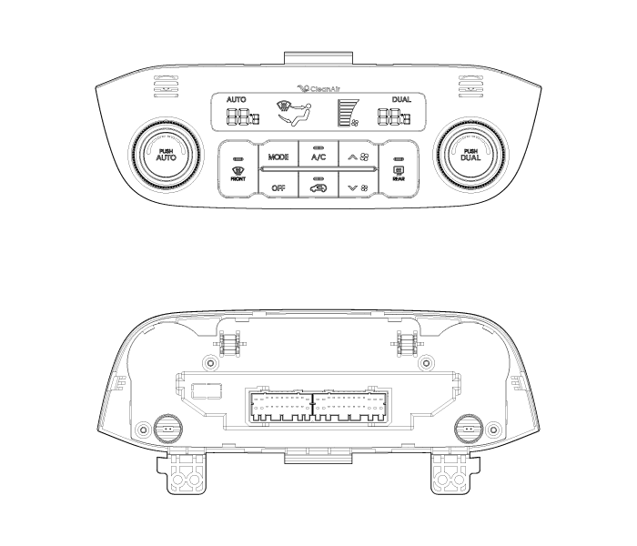

# Unidade de Controle do Aquecedor e Ar-Condicionado (Automático Completo) — Componentes e localização

[Home](../../index.md) / [Manual de Serviço e Reparo](../sportage-482.md) / [Aquecimento, Ventilação, Ar-Condicionado](sportage-1181.md) / [Controlador](sportage-1231.md) / Componentes e localização

## Diagrama

## Função da Conector Pin

| Conector | Número do Pin | Função | Conector | Número do Pin | Função |
| --- | --- | --- | --- | --- | --- |
| Conector(A) | 1 | Bateria | Conector(B) | 1 | CAN (LOW) |
| 2 | Luz Traseira (ILL+) | 2 | CAN (HIGH) |  |  |
| 3 | IG2 | 3 | Atuador de Interação (F/B) |  |  |
| 4 | Atuador de Temperatura do Motor (COOL) | 4 | Atuador de Modo (F/B) |  |  |
| 5 | Atuador de Temperatura do Motor (WARM) | 5 | Atuador de Temperatura do PS (F/B) |  |  |
| 6 | Detent | 6 | Atuador de Temperatura do Motor (F/B) |  |  |
| 7 | Atuador de Modo (VENT) | 7 | Diagnóstico (Cluster Ion) |  |  |
| 8 | Atuador de Modo (DEF) | 8 | V Ref (+5V) |  |  |
| 9 | - | 9 | - |  |  |
| 10 | - | 10 | - |  |  |
| 11 | - | 11 | ECV IN |  |  |
| 12 | Resistência (ILL-) | 12 | GND |  |  |
| 13 | GND | 13 | HI- Scan(L-line) |  |  |
| 14 | IG1 | 14 | Sensor de Evaporador |  |  |
| 15 | Sinal de Ion | 15 | Sensor de Ambiente |  |  |
| 16 | Atuador de Interação (FRE) | 16 | - |  |  |
| 17 | Atuador de Interação (REC) | 17 | Fotoelétrico LH (-) |  |  |
| 18 | Sinal de Limpeza | 18 | Fotoelétrico RH (-) |  |  |
| 19 | Motor de Ventoinha (+) | 19 | - |  |  |
| 20 | Atuador de Temperatura do PS (COOL) | 20 | - |  |  |
| 21 | Atuador de Temperatura do PS (WARM) | 21 | - |  |  |
| 22 | Mosfet de Potência (GATE) | 22 | ECV Out |  |  |
| 23 | Mosfet de Potência (DRAIN) |  |  |  |  |
| 24 | HTD (Indicador de Defroste Traseiro) |  |  |  |  |
| 25 | S/W de Defroste Traseiro (Low) |  |  |  |  |
| 26 | GND do Sensor |  |  |  |  |
