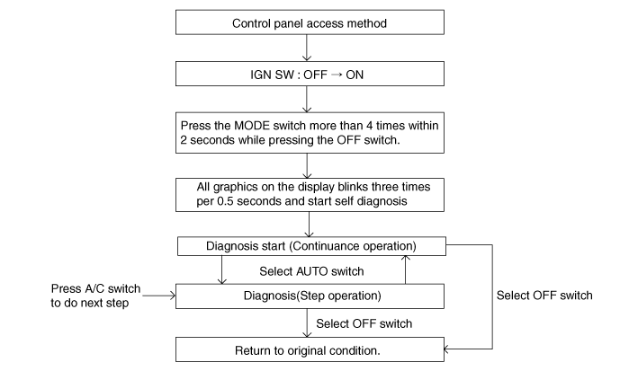
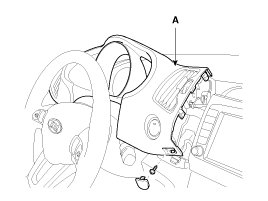
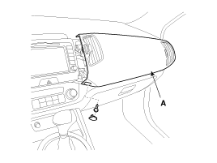
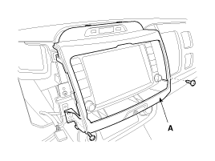
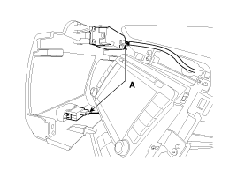
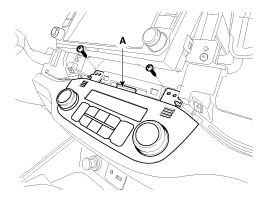
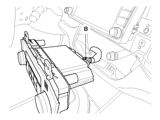

# Kia Sportage: Unidade de Controle do Aquecedor e Ar-Condicionado (Automático Completo): Procedimentos de Reparo

[Início](../../index.md) / [Manual de Serviço e Reparo do Kia Sportage SL](../sportage-482.md) / [Aquecimento, Ventilação, Ar-Condicionado](sportage-1181.md) / [Controlador](sportage-1231.md) / Unidade de Controle do Aquecedor e Ar-Condicionado (Automático Completo): Procedimentos de Reparo

## Diagnóstico Self

1. Processo de diagnóstico self

   

2. Como ler o código de diagnóstico self

   Após o painel de exibição piscar três vezes a cada 0,5 segundo, o código de falha correspondente piscará no painel de temperatura de configuração a cada 0,5 segundo e exibirá dois dígitos. Os códigos são exibidos em formato numérico

   Código de Falha

   | Exibição | Descrição de falha |
   | --- | --- |
   | 00 | Normal |
   | 11 | Sensor interno aberto |
   | 12 | Sensor interno curto |
   | 13 | Sensor de temperatura ambiente aberto |
   | 14 | Sensor de temperatura ambiente curto |
   | 17 | Sensor de evaporador aberto |
   | 18 | Sensor de evaporador curto |
   | 19 | Potenciômetro da porta de temperatura aberto/curto - Motorista |
   | 20 | Falha do potenciômetro da porta de temperatura - Motorista |
   | 21 | Potenciômetro da porta de modo aberto/curto |
   | 22 | Falha do potenciômetro da porta de modo |
   | 25 | Potenciômetro da porta de admissão aberto |
   | 26 | Potenciômetro da porta de admissão curto |
   | 32 | Potenciômetro da porta de temperatura - Passageiro |
   | 33 | Falha do potenciômetro da porta de temperatura - Passageiro |
   | 45 | Falha da sinal APT CAN |
   | 46 | - |
   | 47 | Falha do sinal RPM CAN |
   | 48 | Falha do sinal de velocidade do veículo CAN |
   | 49 | Falha do sinal de temperatura do líquido do motor CAN |
   | 50 | Falha do gerador de íon do cluster |

3. Exibição do código de falha

   | (1) | Operação contínua: Código DTC é um. |
   | --- | --- |

   | (2) | Operação contínua: Código DTC de dois ou mais. |
   | --- | --- |

   | (3) | Operação STEP A. Normal ou um código de falha é o mesmo que uma operação contínua. B. Código DTC é mais de dois. |
   | --- | --- |
   | A. | Normal ou um código de falha é o mesmo que uma operação contínua. |
   | B. | Código DTC é mais de dois. |

4. Se códigos de falha forem exibidos durante a verificação, inspecione as causas específicas das falhas por códigos de falha.

5. Segurança de backup

   | (1) | Sensor de temperatura do carro: Controlar com o valor de 23°C (73,4°F) |
   | --- | --- |

   | (2) | Sensor de temperatura ambiente: Controlar com o valor de 20°C (67°F) |
   | --- | --- |

   | (3) | Sensor de temperatura do evaporador: Controlar com o valor de -2°C (28,4°F) |
   | --- | --- |

   | (4) | Sensor de temperatura do líquido: Controlar com o valor de 85°C (185°F) |
   | --- | --- |

   | (5) | Atuador de controle de temperatura (potenciômetro de mistura de ar): Se a temperatura estiver entre 17°C-24,5°C, fixar no máximo de resfriamento. Se a temperatura estiver entre 25°C-32°C, fixar no máximo de aquecimento. |
   | --- | --- |

   | (6) | Atuador de controle de modo (potenciômetro de direção): Fixar a posição de ventilação, enquanto selecionar o modo de ventilação. Fixar a posição de desumidificação, enquanto selecionar todos, exceto o modo de ventilação. |
   | --- | --- |

   | (7) | Atuador de controle de admissão: Fixar a posição de ar fresco, enquanto selecionar o modo de ar fresco. Fixar a posição de ar recirculado, enquanto selecionar o modo de ar recirculado. |
   | --- | --- |

## Troca

1. Desconecte o terminal negativo (-) da bateria.

2. Usando a ferraça, remova a capa do painel de instrumentos (A).

   

3. Usando a ferraça, remova o adorno do tapete de impacto (A).

   

4. Usando a ferraça, remova o painel de instrumentos central (A).

   

5. Desconecte os conectores do painel central (A).

   

6. Ajuste os parafusos de montagem do painel de controle e, em seguida, remova o painel de controle (A).

   

7. Desconecte os conectores e, em seguida, remova o painel de controle (B).

   

8. A instalação deve ser feita na ordem inversa da remoção.
