# Kia Sportage: Informações Gerais

[Home](../../index.md) / [Manual de Serviço e Reparo do Kia Sportage SL](../sportage-482.md) / Informações Gerais

## Localizações do Número de Identificação

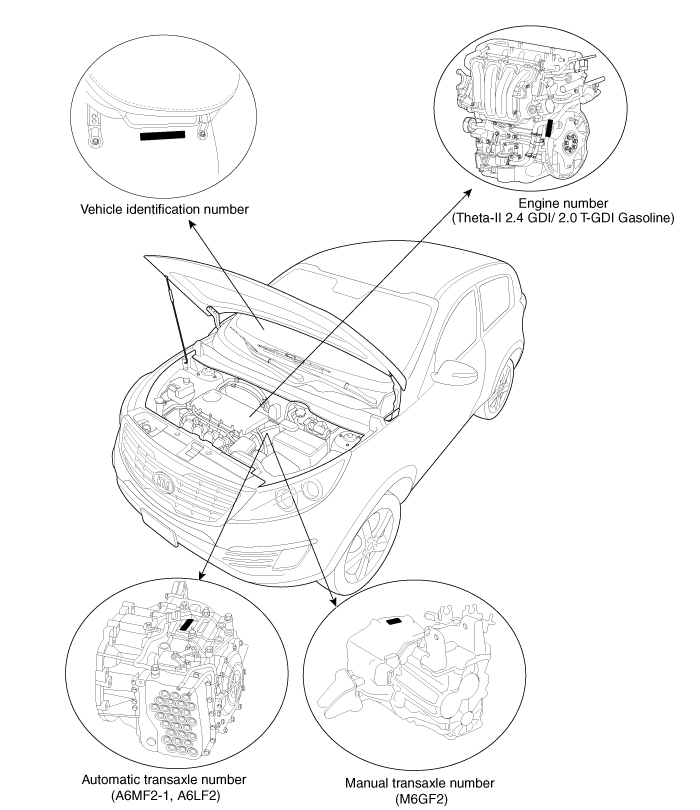

Descrição do Número de Identificação

Número de Identificação do Veículo

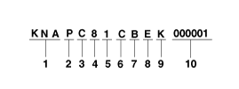

1. Identificador do Fabricante do Mundo (WMI)

   - KNA : Veículos passageiros, MPV (Veículo Multifuncional)/SUV (Veículo Utilitário Esportivo)/RV (Veículo Recreativo)

   - KNC : Veículos comerciais (Van)

   - KND : MPV/SUV/RV (Para Estados Unidos, Canadá, México)

   - KNH : Van

2. Linha do Veículo

   - P : SPORTAGE

3. Modelo & Série

   - A : Baixa grade (L)

   - B : Média-baixa grade (GL)

   - C : Média grade (GLS, JSL, TAX)

   - D : Média-alta grade (HGS)

   - E : Alta grade (TOP)

4. Tipo do Corpo/Cabinato, Peso Bruto do Veículo

   KNA

   - 1 : Limusine

   - 2 : Sedan - 2 portas

   - 3 : Sedan - 3 portas

   - 4 : Sedan - 4 portas

   - 5 : Sedan - 5 portas

   - 6 : Coupé

   - 7 : Convertível

   - 8 : Station Wagon

   - 9 : Van Comercial

   - 0 : Pick-Up

   KNC (Veículos comerciais / Van)

   Exceto Estados Unidos, Canadá, México, Conselho de Cooperação do Golfo, China

   - X : Cabine Padrão / Cabine Semi-Boné

   - Y : Cabine Dupla / Cabine Boné

   - Z : Cabine Super / Caixa

   Para Estados Unidos, Canadá, México, Conselho de Cooperação do Golfo, China

   - 2 : Cabine Padrão Classe-H 4?2

   - 3 : Cabine Padrão Classe-E 4?2 / Cabine Semi-Boné Classe-E 4?2

   - 4 : Cabine Padrão Classe-E 4?4 / Cabine Semi-Boné Classe-E 4?4

   - 5 : Cabine Padrão Classe-F 4?2 / Cabine Semi-Boné Classe-F 4?2

   - 6 : Cabine Padrão Classe-F 4?4 / Cabine Semi-Boné Classe-F 4?4

   - 7 : Cabine Dupla Classe-E 4?2 / Cabine Boné Classe-E 4?2

   - 8 : Cabine Dupla Classe-E 4?4 / Cabine Boné Classe-E 4?4

   - 9 : Cabine Dupla Classe-F 4?2 / Cabine Boné Classe-F 4?2

   - 0 : Cabine Dupla Classe-F 4?4 / Cabine Boné Classe-F 4?4

   - A : Cabine Super Classe-E 4?2 / Caixa Classe-E 4?2

   - B : Cabine Super Classe-E 4?4 / Caixa Classe-E 4?4

   - C : Cabine Super Classe-F 4?2 / Caixa Classe-F 4?2

   - D : Cabine Super Classe-F 4?4 / Caixa Classe-F 4?4

   KND

   - 1 : Station Wagon 4?2 Classe-A

   - 2 : Station Wagon 4?2 Classe-B

   - 3 : Station Wagon 4?2 Classe-C

   - 4 : Station Wagon 4?2 Classe-D

   - 5 : Station Wagon 4?2 Classe-E

   - 6 : Station Wagon 4?2 Classe-F

   - 7 : Station Wagon 4?2 Classe-G

   - A : Station Wagon 4?4 Classe-A

   - B : Station Wagon 4?4 Classe-B

   - C : Station Wagon 4?4 Classe-C

   - D : Station Wagon 4?4 Classe-D

   - E : Station Wagon 4?4 Classe-E

   - F : Station Wagon 4?4 Classe-F

   - G : Station Wagon 4?4 Classe-G

   KNH

   - 1 : Caixa

   - 2 : Cabine Boné

   - 3 : Cabine Semi-Boné

5. Sistema de Restrição, Sistema de Freio

   KNA, KND

   Exceto Estados Unidos, Canadá, México

   - 0 : Ambos os lados - Nenhum

   - 1 : Ambos os lados - Cinto ativo

   - 2 : Ambos os lados - Cinto passivo

   Para Estados Unidos, Canadá, México

   | Código | Cinto de segurança | Ar de frente do motorista | Ar de joelho do motorista | Ar lateral do motorista | Ar de cortina do motorista | --- | --- | --- | --- | --- | --- | --- | --- | --- | --- | --- | --- |
   | --- | --- | --- | --- | --- | --- | --- | --- | --- | --- | --- | --- |
   | Motorista | Passageiro | Motorista | Passageiro | 1ª fila | 2ª fila | 3ª fila | 1ª fila | 2ª fila | 3ª fila | --- | --- | --- | --- | --- | --- | --- | --- | --- | --- | --- | --- | --- | --- | --- | --- | --- | --- | --- | --- | --- | --- | --- | --- | --- | --- | --- | --- | --- | --- | --- | --- | --- | --- | --- | --- | --- | --- | --- | --- | --- | --- | --- | --- | --- | --- | --- | --- | --- | --- | --- | --- | --- | --- | --- | --- | --- | --- | --- | --- | --- | --- | --- | --- | --- | --- | --- | --- | --- | --- | --- | --- | --- | --- | --- | --- | --- | --- | --- | --- | --- | --- | --- | --- | --- | --- | --- | --- | --- | --- | --- | --- | --- | --- | --- | --- | --- | --- | --- | --- | --- | --- | --- | --- | --- | --- | --- | --- | --- | --- | --- | --- | --- | --- | --- | --- | --- | --- | --- | --- | --- | --- | --- | --- | --- | --- | --- | --- | --- | --- | --- | --- | --- | --- | --- | --- | --- | --- | --- | --- | --- | --- | --- | --- | --- | --- | --- | --- | --- | --- | --- | --- | --- | --- | --- | --- | --- | --- | --- | --- | --- | --- | --- | --- | --- | --- | --- | --- | --- | --- | --- | --- | --- | --- | --- | --- | --- | --- | --- | --- | --- | --- | --- | --- | --- | --- | --- | --- | --- | --- | --- | --- | --- | --- | --- | --- | --- | --- | --- | --- | --- | --- | --- | --- | --- | --- | --- | --- | --- | --- | --- | --- | --- | --- | --- | --- | --- | --- | --- | --- | --- | --- | --- | --- | --- | --- | --- | --- | --- | --- | --- | --- | --- | --- | --- | --- | --- | --- | --- | --- | --- | --- | --- | --- | --- | --- | --- | --- | --- | --- | --- | --- | --- | --- | --- | --- | --- | --- | --- | --- | --- | --- | --- | --- | --- | --- | --- | --- | --- | --- | --- | --- | --- | --- | --- | --- | --- | --- | --- | --- | --- | --- | --- | --- | --- | --- | --- | --- | --- | --- | --- | --- | --- | --- | --- | --- | --- | --- | --- | --- | --- | --- | --- | --- | --- | --- | --- | --- | --- | --- | --- | --- | --- | --- | --- | --- | --- | --- | --- | --- | --- | --- | --- | --- | --- | --- | --- | --- | --- | --- | --- | --- | --- | --- | --- | --- | --- | --- | --- | --- | --- | --- | --- | --- | --- | --- | --- | --- | --- | --- | --- | --- | --- | --- | --- | --- | --- | --- | --- | --- | --- | --- | --- | --- | --- | --- | --- | --- | --- | --- | --- | --- | --- | --- | --- | --- | --- | --- | --- | --- | --- | --- | --- | --- | --- | --- | --- | --- | --- | --- |

| C | 0 | 0 | 0 | ? | ? | 0 | ? | ? | 0 | 0 | 0 |
   | D | 0 | 0 | 0 | ? | ? | 0 | 0 | ? | 0 | 0 | ? |
   | E | 0 | 0 | ? | ? | ? | ? | ? | ? | ? | ? | ? |
   | F | 0 | 0 | 0 | ? | ? | 0 | ? | ? | ? | ? | ? |
   | J | 0 | 0 | 0 | 0 | ? | 0 | 0 | ? | 0 | 0 | ? |
   | L | 0 | 0 | 0 | 0 | ? | 0 | ? | ? | 0 | 0 | ? |
   | N | 0 | ? | ? | ? | ? | ? | ? | ? | ? | ? | ? |
   | G | 0 | 0 | 0 | 0 | ? | ? | ? | ? | 0 | 0 | ? |
   | H | 0 | 0 | 0 | 0 | ? | 0 | ? | ? | 0 | 0 | 0 |

   KNC, KNH

   Exceto Estados Unidos, Canadá, México

   - 7 : Sistema de freio hidráulico

   - 8 : Sistema de freio pneumático

   - 9 : Sistema de freio misto

   Para Estados Unidos, Canadá, México

   - X : Sistema de freio hidráulico

   - Y : Sistema de freio pneumático

   - Z : Sistema de freio misto

6. Tipo do motor

   - C : Motor a gasolina 2.4 GDI (Theta-II)

   - 6 : Motor a gasolina 2.0 T-GDI (Theta-II)

7. Dígito verificador ou Lado do motorista & Transmissão

   Exceto Estados Unidos, Canadá, México, Conselho de Cooperação do Golfo, China, Iêmen

   - A : LHD & MT

   - B : LHD & AT

   - C : LHD & MT+Transfer

   - D : LHD & AT+Transfer

   - E : LHD & CVT

   - L : RHD & MT

   - M : RHD & AT

   - N : RHD & MT+Transfer

   - S : RHD & AT+Transfer

   - T : RHD & CVT

   Para Estados Unidos, Canadá, México, Conselho de Cooperação do Golfo, China, Iêmen

   - Dígito verificador : 0 ~ 9, ?

8. Ano do modelo

   - E : 2014, F : 2015, G : 2016, H : 2017 …

9. Fábrica de produção

   - 5 : Hwasung (Coreia)

   - 6 : Sohari (Coreia)

   - 7 : Kwangju (Coreia)

   - T : Seosan (Coreia)

10. Número de sequência do veículo

    - 000001 ~ 999999

Código de Pintura

| Código | Cor |
| --- | --- |
| UD | Branco Claro |
| 9P | Cereja Preto |
| 3D | Prata Brilhante |
| E6S | Prata Mineral |
| D2A | Orange Técnico |
| D5U | Rotação de Areia |
| BAH | Azul Antigo |
| BEG | Vermelho Sinal |
| D2B | Amarelo Eletrônico |

Número do Motor

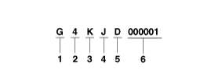

1. Combustível do motor

   - G : Gasolina

2. Faixa do motor

   - 4 : 4 cilindros em linha 4 tempos

3. Desenvolvimento do motor e capacidade

   - K : Motor Theta (Gasolina)

4. Capacidade do motor

   - H : 1998cc (Motor Theta-II T-GDI)

   - J : 2359cc (Motor Theta-II GDI)

5. Ano de produção

   - D : 2013, E : 2014, F : 2015, G : 2016 …

6. Fábrica de produção

   - A : Asan (Coreia)

   - B : Beijing (China)

   - H : Hwasung (Coreia)

   - K : Montgomery (Estados Unidos)

   - M : Chennai (Índia)

   - P : Poseung (Coreia)

   - S : Sohari (Coreia)

   - T : Izmit (Turquia)

   - U : Ulsan (Coreia)

   - W : Shandong (China)

   - Z : Zilina (Eslováquia)

   - 1 : Yancheng (China)

7. Número de sequência de produção do motor

    - 000001 ~ 999999

Número de Transmissão

Manual

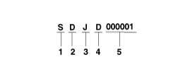

1. Modelo

   - S : M6GF2

2. Ano de produção

   - D : 2013, E : 2014, F : 2015, G : 2016 …

3. Fábrica de produção

   - J : Hwaseong (Coreia)

4. Razão final do engraxado

   - D : 5.071 / 3.737

5. Número de sequência de produção da transmissão

    - 000001 ~ 999999

Automático

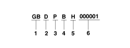

1. Modelo

   - GB : A6MF2-1 (Theta-II 2.4 MPI 2WD)

- GD : A6MF2-1 (Theta-II 2.4 MPI 4WD)

   - BB : A6LF2 (Theta-II 2.0 T-GDI 2WD)

   - BD : A6LF2 (Theta-II 2.0 T-GDI 4WD)

2. Ano de produção

   - D : 2013, E : 2014, F : 2015, G : 2016 …

3. Razão final do câmbio

   - R : 3.195

   - P : 3.064

   - F : 3.320

4. Classificação detalhada

   - B : Theta-II 2.0 T-GDI / 2.4 GDI

5. Planta de produção

   - 2 : HPT Plant 2

   - 4 : HPT Plant 4

   - U : Ulsan plant 1

   - S : Ulsan plant 2

   - N : Ulsan plant 3

   - A : PTA

   - H : Hwasung

   - C : PTC

6. Sequência de produção do transmissão

   - 000001 ~ 999999

Etiquetas de advertência / cautela

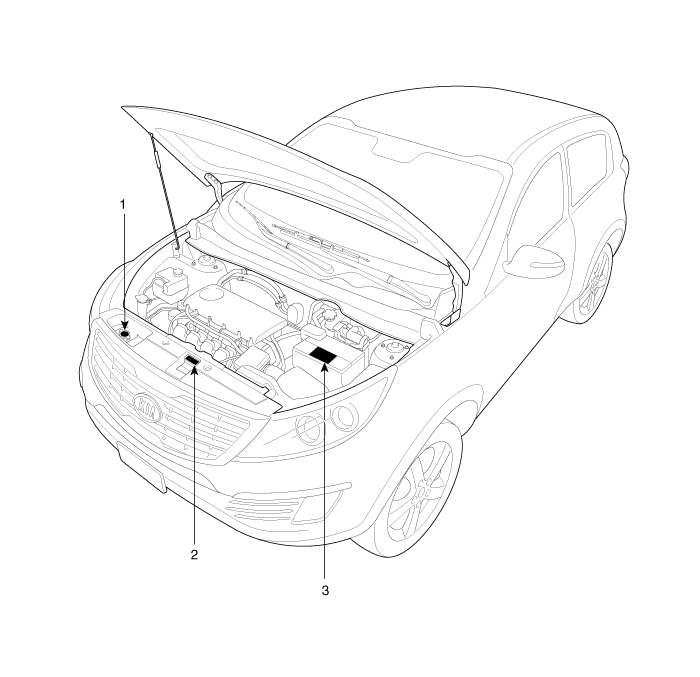

| 1. Caution do tampão do radiador 2. Caution do ventilador | 3. Caution da bateria |
| --- | --- |

Descrição da etiqueta de advertência da bateria

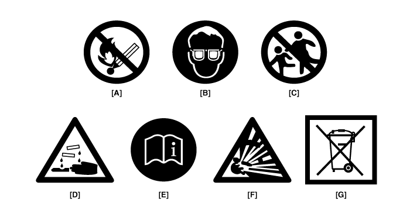

Etiquetas de advertência / cautela (cont.)

A. Manter cigarros acesos e todos os outros fósforos ou chamas afastados da bateria.

| B. Use proteção ocular ao carregar ou trabalhar perto de uma bateria. Sempre forneça ventilação ao trabalhar em um espaço fechado. • Ao levantar uma bateria de caixa plástica, pressão excessiva pode causar derramamento de ácido, resultando em ferimentos pessoais. Levante com um carrinho de bateria ou segure nas extremidades opostas. • Nunca tente trocar a bateria quando os cabos da bateria estão conectados. • O sistema de ignição elétrico trabalha com alta tensão. Nunca toque nessas componentes com o motor ligado ou a ignição ligada. |  |
| --- | --- |
| • | Ao levantar uma bateria de caixa plástica, pressão excessiva pode causar derramamento de ácido, resultando em ferimentos pessoais. Levante com um carrinho de bateria ou segure nas extremidades opostas. |
| • | Nunca tente trocar a bateria quando os cabos da bateria estão conectados. |
| • | O sistema de ignição elétrico trabalha com alta tensão. Nunca toque nessas componentes com o motor ligado ou a ignição ligada. |

C. Manter as baterias fora do alcance de crianças, pois as baterias contêm ácido sulfúrico altamente corrosivo. Não permita que ácido da bateria entre em contato com sua pele, olhos, roupas ou acabamento pintado.

D. Se qualquer eletrólito entrar nos seus olhos, lave-os com água limpa por pelo menos 15 minutos e procure atendimento médico imediato. Se possível, continue a aplicar água com um pano ou pano até que o atendimento médico seja recebido. Se o eletrólito entrar na sua pele, lave a área em contato com água até que a pele esteja limpa. Se você sentir dor ou sensação de queimação, procure atendimento médico imediatamente.

E. Sempre leia as instruções a seguir cuidadosamente ao manipular uma bateria.

F. Hidrogênio, um gás altamente inflamável, está sempre presente nas células da bateria e pode explodir se for acionado.

G. Uma bateria mal descartada pode ser prejudicial ao meio ambiente e à saúde humana. Sempre confirme as regulamentações locais para o descarte de baterias.

Manuseio e armazenamento da bateria

| Bateria Ela Mesma | • As baterias devem ser armazenadas em locais frescos e secos (27°C / 80,6°F) e longe de luz solar direta. • As baterias MF estão estanquemente seladas para prevenir a perda de ácido. No entanto, inclinar a bateria a um ângulo de 45 graus pode causar a perda de ácido através dos válvulos laterais. Portanto, as baterias devem sempre ser armazenadas em suas posições verticais. Evite colocar qualquer corpo aquoso ou sólido (i.e. condutores) sobre a bateria. • É extremamente perigoso usar ferramentas, como martelos, nos terminais da bateria quando estiver conectando cabos à bateria montada. |
| --- | --- |
| • | As baterias devem ser armazenadas em locais frescos e secos (27°C / 80,6°F) e longe de luz solar direta. |
| • | As baterias MF estão estanquemente seladas para prevenir a perda de ácido. No entanto, inclinar a bateria a um ângulo de 45 graus pode causar a perda de ácido através dos válvulos laterais. Portanto, as baterias devem sempre ser armazenadas em suas posições verticais. Evite colocar qualquer corpo aquoso ou sólido (i.e. condutores) sobre a bateria. |
| • | É extremamente perigoso usar ferramentas, como martelos, nos terminais da bateria quando estiver conectando cabos à bateria montada. |
| Bateria no Veículo | • Quando o veículo estiver armazenado por períodos prolongados, certifique-se de remover o fusível de memória na caixa de juntamento para prevenir a descarga natural. • Também, ligue o motor para recarregar a bateria dentro de 1 mês se o fusível de memória não foi removido desde o início do armazenamento do veículo. Se o fusível de memória foi removido, ligue o motor para recarregar a bateria dentro de 3 meses desde o início do armazenamento do veículo. |
| • | Quando o veículo estiver armazenado por períodos prolongados, certifique-se de remover o fusível de memória na caixa de juntamento para prevenir a descarga natural. |
| • | Também, ligue o motor para recarregar a bateria dentro de 1 mês se o fusível de memória não foi removido desde o início do armazenamento do veículo. Se o fusível de memória foi removido, ligue o motor para recarregar a bateria dentro de 3 meses desde o início do armazenamento do veículo. |

> **Nota**
>
> - Após conectar ou recarregar uma bateria descarregada, o indicador ESC OFF pode acender.
> - Neste caso, vire o manopla metade para a esquerda e para a direita enquanto o interruptor de ignição estiver na posição ON.
> - Em seguida, reinicie o motor após o desligamento da ignição.
> - O indicador ESC OFF pode se apagar.
> - Se o indicador ESC OFF não se apagar, verifique o sistema referindo-se a DTC.

Pontos de Elevação e Suporte

> **Aviso**
>
> - Quando componentes pesados do reboque, como suspensão, tanque de combustível, pneu de emergência, porta-malas e porta-malas, precisarem ser removidos, coloque peso adicional na área de bagagem antes de levantar. Quando peso significativo for removido do reboque, o centro de gravidade pode mudar e pode causar o veículo a se inclinar para frente no elevador.

> **Nota**
>
> - Como cada conjunto de pneu/roda pesa aproximadamente 14kg (30lbs), colocar os pneus dianteiros na área de bagagem pode auxiliar na distribuição do peso.
> - Use os mesmos pontos de suporte para suportar o veículo em plataformas de segurança.

1. Coloque as travas sob os pontos de apoio conforme ilustrado.

2. Levante o elevador alguns polegadas (centímetros) e balançe o veículo para garantir que esteja firmemente apoiado.

3. Levante o elevador ao máximo para inspecionar os pontos de elevação para apoio seguro.

   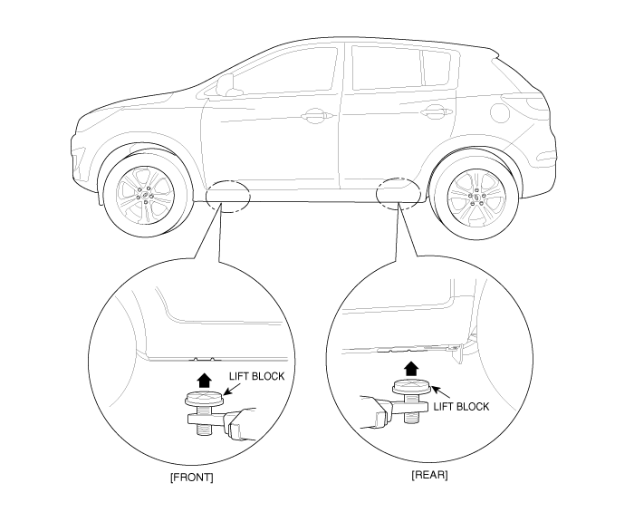

Towagem

Se o veículo precisar ser towado, chame um serviço de towagem profissional. Nunca towagem com apenas uma corda ou corrente. É muito perigoso.

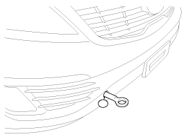

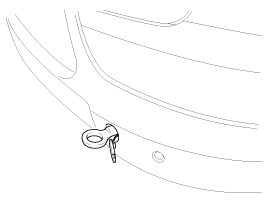

Towagem de Emergência

Existem três métodos populares de towagem de veículo:

| – | O operador carrega o veículo no fundo de um caminhão. Este é o melhor método de transportar o veículo. |
| --- | --- |

| – | O caminhão de towagem usa dois braços articulados que passam sob os pneus do eixo de direção e levantam os pneus do eixo de direção do chão. Os outros dois pneus permanecem no chão. |
| --- | --- |

| – | O caminhão de towagem usa cabos metálicos com enganchos nos extremos. Esses enganchos passam por partes do quadro ou suspensão, e os cabos levantam essa parte do veículo do chão. O suspensão e o corpo do veículo podem ser seriamente danificados se este método de towagem for tentado. Se o veículo não puder ser transportado em plataforma, deve ser towado com os pneus do eixo de direção no chão e faça o seguinte: |
| --- | --- |

Transaxle Manual

| • | Libere o travamento de estacionamento. |
| --- | --- |

| • | Coloque o transaxle em neutral. |
| --- | --- |

Transaxle Automático

| • | Libere o travamento de estacionamento. |
| --- | --- |

| • | Inicie o motor. |
| --- | --- |

| • | Coloque em posição [D], depois em posição [N]. |
| --- | --- |

| • | Desligue o motor. |
| --- | --- |

> **Cuidado**
>
> - O veículo equipado com 4WD permanente deve ser transportado apenas em plataforma.
> - Preparação inadequada de towagem danificará o transaxle. Siga exatamente o procedimento acima. Se você não puder colocar o transaxle em posição ou iniciar o motor (transaxle automático), o veículo deve ser transportado em plataforma.
> - O melhor é towar o veículo a no máximo 30km (19milhas), e manter a velocidade abaixo de 50km/h (30mph). (Para o veículo 4WD permanente, limite a towagem a 1,5km (1milha) e 15km/h (10mph).)
> - Tentar levantar ou towar o veículo pelos para-choques causará danos sérios. Os para-choques não são projetados para suportar o peso do veículo.

Significado dos Símbolos

Existem cinco símbolos primários usados para complementar as ilustrações. Esses símbolos indicam a parte a aplicar tais materiais durante a manutenção.

| Símbolo | Significado |
| --- | --- |
|  | Não reutilize a peça. Substitua por uma nova. |
|  | Aplicar óleo do motor ou óleo de transmissão na peça. |
|  | Aplicar fluido de transmissão automática (ATF) na peça. |
|  | Aplicar graxa na peça. |
|  | Aplicar selante na peça. |

Informações Gerais de Serviço

Proteção do Veículo

Sempre cubra os para-choques, os assentos e as áreas do chão antes de começar o trabalho.

> **Cuidado**
>
> - A haste de apoio deve ser inserida na abertura próxima ao contorno.

da capota sempre que inspecionar o compartimento do motor para prevenir a queda da capota e causar possíveis ferimentos.
> - Libere o cabo de apoio antes de fechar a capota. Sempre verifique se a capota está firmemente lacrada antes de dirigir o veículo.

Preparação das Ferramentas e Equipamentos de Medição

Certifique-se de que todas as ferramentas e equipamentos de medição necessários estejam disponíveis antes de iniciar o trabalho.

Ferramentas Especiais

Use ferramentas especiais quando necessário.

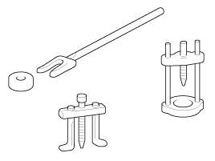

Remoção de Peças

Primeiro, identifique a causa do problema e, em seguida, determine se a remoção ou desmontagem é necessária antes de iniciar o trabalho.

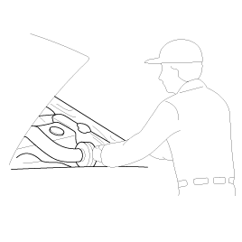

Desmontagem

Se o procedimento de desmontagem for complexo, exigindo o desmontagem de muitas peças, todas as peças devem ser desmontadas de forma que não afetem seu desempenho ou aparência externa.

| 1) | Inspeção das peças Cada peça, quando removida, deve ser cuidadosamente inspecionada para verificar falhas, deformações, danos e outros problemas. |
| --- | --- |

| 2) | Disposição das peças Todas as peças desmontadas devem ser cuidadosamente dispostas para uma reunião eficaz. Certifique-se de separar e identificar corretamente as peças a serem substituídas das que serão usadas novamente. |
| --- | --- |

| 3) | Limpeza das peças para reutilização Todas as peças a serem usadas novamente devem ser limpas cuidadosamente e completamente por um método apropriado. |
| --- | --- |

Peças

Ao substituir peças, use peças genuínas da KIA MOTORS.

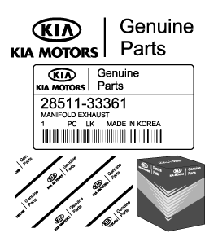

Substituição

Valores padrão, como torques e certas ajustes, devem ser observados rigorosamente na reunião de todas as peças.

Se removidas, as seguintes peças devem ser substituídas sempre por novas.

| 1) | Selos de óleo |
| --- | --- |

| 2) | Selos |
| --- | --- |

| 3) | Anéis O-rings |
| --- | --- |

| 4) | Parafusos de travamento |
| --- | --- |

| 5) | Pinos (pinos de divisão) |
| --- | --- |

| 6) | Parafusos plásticos Dependendo de sua localização. |
| --- | --- |

| 7) | Selante deve ser aplicado aos selos. |
| --- | --- |

| 8) | Óleo deve ser aplicado aos componentes em movimento. |
| --- | --- |

| 9) | Óleo ou graxa especificados devem ser aplicados às localizações prescritas (selos, etc) antes da montagem. |
| --- | --- |

Ajuste

Use guisados e testadores para ajustar corretamente as peças aos valores padrão corretamente.

Sistema Elétrico

1. Certifique-se de desconectar o cabo do bocal do terminal negativo (-) do baterista.

2. Nunca puxe as fios quando desconectar os conectores.

3. Conectores com travamento clicarão quando o conector estiver seguro.

4. Trate cuidadosamente sensores e relés. Cuide para não deixá-los cair contra outras peças.

   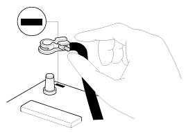

Peças Elásticas e Tubos

Sempre evite que o combustível entre em contato com peças elásticas ou tubos.

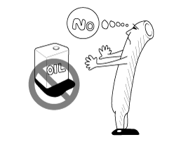

Medição das Dimensões do Corpo

1. Basicamente, todas as medições neste manual são feitas com um guisado de rastreamento.

2. Quando uma fita métrica for utilizada, verifique se não há alongamento, torção ou curvatura.

3. Para medir dimensões, tanto as dimensões projetadas quanto as medidas reais são utilizadas neste manual.

Dimensões Projetadas

1. Essas são as dimensões medidas quando os pontos de medição são projetados da superfície do veículo, e são as dimensões de referência utilizadas para alterações no corpo do veículo.

2. Se a extensão dos pinos do guia de traçado for ajustável, mede-se a extensão de um dos dois pinos para que ele seja igual à diferença de altura entre as duas superfícies.

   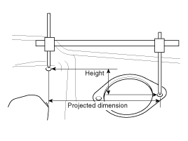

Medindo Dimensões Reais

1. Essas dimensões indicam a distância linear real entre os pontos de medição, e são utilizadas como dimensões de referência quando um guia de traçado é usado para medição.

2. Antes da medição, ajuste os dois pinos para a mesma extensão (A=A'').

   > **Nota**
   >
   > - Verifique os pinos e o guia para garantir que não haja movimento livre.

   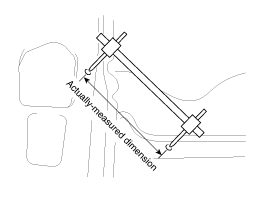

Ponto de Medição

As medições devem ser realizadas no centro do orifício.

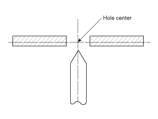

Verificação de Cabos e Fios

1. Verifique a terminal para verificar a apertura.

2. Verifique as terminais e os fios para corrosão devido a ácido do eletrólito da bateria, etc.

3. Verifique as terminais e os fios para circuitos abertos.

4. Verifique a cobertura e a isolação do fio para danos, rachaduras e degradação.

5. Verifique as partes condutivas das terminais para contato com outras partes metálicas (corpo do veículo e outras partes).

6. Verifique as partes conectadas para garantir a continuidade completa entre os parafusos de fixação e o corpo do veículo.

7. Verifique a disposição errada dos fios.

8. Verifique que os fios estejam presos para evitar contato com cantos afiados do corpo do veículo, etc. ou partes quentes (exaustão, etc.).

9. Verifique que os fios estejam presos firmemente para proporcionar uma distância suficiente das partes girantes ou em movimento, como o puliador do ventilador, o cinto do ventilador e outras partes girantes.

10. Verifique que os fios tenham um pouco de espaço para poder vibrar entre partes fixas e móveis, como o corpo do veículo e o motor.

   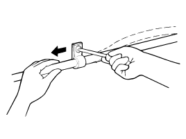

Verificação de Fusíveis

Os pinos de teste do fusível do tipo lâmina fornecidos permitem verificar o fusível sem removê-lo da caixa de fusíveis. O fusível está bom se a lâmpada de teste acender quando uma das extremidades é conectada aos pinos de teste (um de cada vez) e a outra extremidade é terra. (Ligue o interruptor de ignição para que a circulação do fusível se torne operativa)

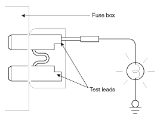

Manutenção do Sistema Elétrico

1. Antes de realizar a manutenção do sistema elétrico, certifique-se de desligar o interruptor de ignição e desconectar o cabo de terra da bateria.

   > **Nota**
   >
   > - Durante a diagnóstico do sistema MFI ou ELC, quando o cabo de terra da bateria é removido, qualquer código de falha armazenado na computação será apagado. Portanto, se necessário, registre os dados de diagnóstico antes de remover o cabo de terra da bateria.

Translate this Markdown chunk (9/10) para o português brasileiro.

   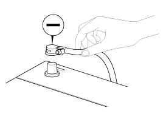

2. Fixe os cabos de alimentação com engates para que não haja
   frouxidão. No entanto, para qualquer cabo que passe pelo motor ou outras
   partes vibrantes do veículo, permita algum frouxo dentro de um intervalo que
   não permita que as vibrações do motor causem o contato do cabo com qualquer
   parte circundante e, em seguida, fixe o cabo usando um engate.

   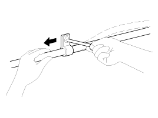

3. Se alguma seção de um cabo de alimentação intervier com o
   limite de uma peça, ou um canto, embrulhe a seção do cabo com fita ou
   algo semelhante para protegê-lo de danos.

   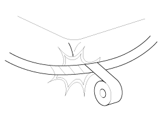

4. Ao instalar peças, tenha cuidado para não apertar ou danificar
   nenhum dos cabos de alimentação.

   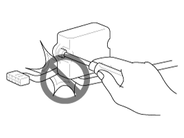

5. Nunca lance relays, sensores ou peças elétricas, ou expô-las a choques fortes.

   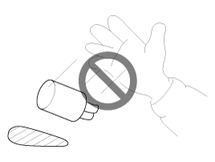

6. As partes eletrônicas usadas no computador, relays, etc. são
   facilmente danificadas pelo calor. Se houver operações de serviço que
   possam causar uma temperatura superior a 80°C (176°F), remova as
   partes eletrônicas antes disso.

   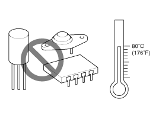

7. Conectores soltos causam problemas. Certifique-se de que os conectores estejam sempre firmemente fixados.

   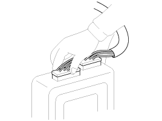

8. Ao desconectar um conector, segure apenas o conector, não as fios.

   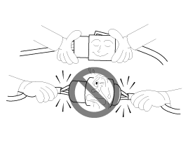

9. Desconecte conectores que têm engates pressionando na direção indicada pelas setas na ilustração.

   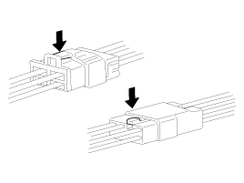

10. Conecte conectores que têm engates inserindo os conectores até que eles façam um som de clique.

   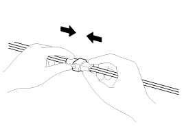

11. Ao usar um teste de circuito para verificar a continuidade ou a tensão nos terminais do conector, insira o pino de teste no lado do cabo. Se o conector for um conector selado, insira o pino de teste através do orifício na capa de borracha até atingir o terminal, com cuidado para não danificar a isolamento das fios.

   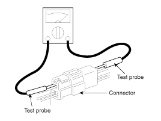

12. Para evitar sobrecarregar o cabo, considere a carga elétrica
   do equipamento opcional e determine o tamanho adequado do cabo.

   | Tamanho nominal | Número de guia SAE | Corrente permitida | |
   | --- | --- | --- | --- |
   | No compartimento do motor | Outras áreas | | |
   | 0,3mm? | AWG 22 | - | 5A |
   | 0,5mm? | AWG 20 | 7A | 13A |
   | 0,85mm? | AWG 18 | 9A | 17A |
   | 1,25mm? | AWG 16 | 12A | 22A |
   | 2,0mm? | AWG 14 | 16A | 30A |
   | 3,0mm? | AWG 12 | 21A | 40A |
   | 5,0mm? | AWG 10 | 31A | 54A |

Precauções Para o Conversor Catalítico

> **Cuidado**
>
> - Se uma grande quantidade de gasolina não queimada fluir para o
   conversor, ele pode aquecer-se excessivamente e criar um risco de
   incêndio. Para evitar isso, observe as seguintes precauções e explique-as ao
   seu cliente.

1. Use apenas gasolina sem chumbo.

2. Não deixe o motor rodando por um longo tempo quando o carro estiver parado. Evite deixar o motor em rotação rápida por mais de 10 minutos e em rotação lenta por mais de 20 minutos.

3. Não realize medições de compressão do motor por um tempo prolongado. As medições de compressão devem ser realizadas o mais rapidamente possível. Desconecte o relé do bomba de combustível antes de realizar uma medição de compressão.

4. Não descarte o conversor catalítico usado junto com peças contaminadas com gasolina ou óleo.
