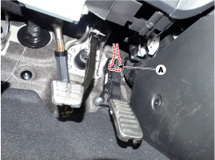
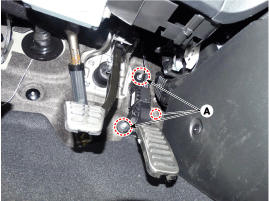

# Pedal do acelerador — procedimentos

[Home](../../index.md) / [Manual de Serviço e Reparo](../sportage-482.md) / [Motorização NU](index.md) / Pedal do acelerador — procedimentos

## Remoção

1. Desligue o interruptor de ignição e desconecte o cabo negativo (-) da bateria.

2. Desconecte o conectador do sensor de posição do pé do acelerador (A).

   

3. Remova as engrenagens de instalação (A) e, em seguida, remova o módulo do pé do acelerador.

   

## Instalação

1. A instalação é o inverso da remoção.

   ```
   Mão de roda do módulo do pé do acelerador:
   12,8 ~ 15,7 N.m (1,3 ~ 1,6 kgf.m, 9,4 ~ 11,6 lb-ft)
   ```
