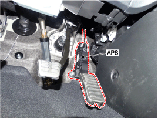

# Kia Sportage SL: Motorização NU / Accelerator Position Sensor (APS) Description and Operation

[Início](../../index.md) / [Manual de Serviço do Kia Sportage NU](index.md) / [Sistema de Controle e Sistema de Combustível](nu-engine_control_fuel_system-3018.md) / [Sistema de Controle do Motor](nu-engine_control_system-3023.md) / Descrição e Operação do Sensor de Posição do Acelerador (SPA)

## Descrição

Sensor de Posição do Acelerador (SPA) é instalado no módulo do acelerador e detecta o ângulo de rotação do acelerador. O SPA é um dos sensores mais importantes no sistema de controle do motor, então consiste em dois sensores que adaptam a linha de poder e a linha de terra do sensor individual. O segundo sensor monitora o primeiro e sua tensão de saída é metade da do primeiro. Se a razão entre os sensores 1 e 2 estiver fora do intervalo (aproximadamente 1/2), o sistema de diagnóstico julga que é anormal.

