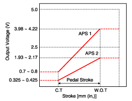

# Sensor APS (posição do acelerador) — especificações

[Home](../../index.md) / [Manual de Serviço e Reparo](../sportage-482.md) / [Motorização NU](index.md) / Sensor APS (posição do acelerador) — especificações

## Especificações

| Posição do Acelerador | Tensão de Saída (V) |  |
| --- | --- | --- |
| SPA1 | SPA2 |  |
| C.T | 0,7 ~ 0,8 | 0,325 ~ 0,425 |
| ATO | 3,98 ~ 4,22 | 1,93 ~ 2,17 |

