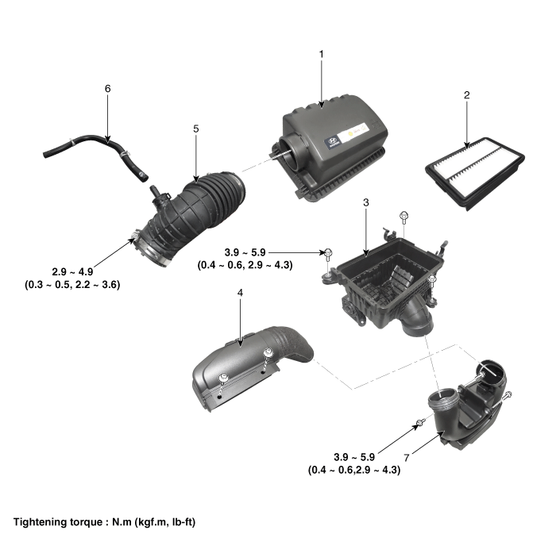

# Kia Sportage SL: Motorização NU / Air Cleaner Components and Components Location

[Home](../../index.md) / [Kia Sportage SL Service & Repair Manual](../sportage-482.md) / [Motorização NU](index.md) / Air Cleaner Components and Components Location

## Componentes

| 1. Capa do filtro de ar 2. Elemento do filtro de ar 3. Corpo do filtro de ar 4. Ducto de admissão de ar | 5. Mangote de admissão de ar 6. Mangote de respiração 7. Resonador |
| --- | --- |
