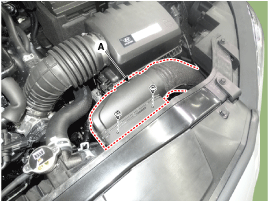
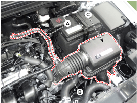
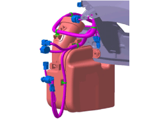
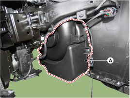
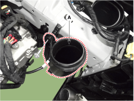
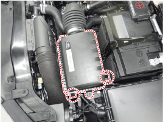
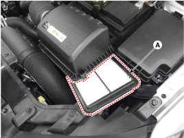

# Kia Sportage SL: Motorização NU / Air Cleaner Repair procedures

[Home](../../index.md) / [Kia Sportage SL Service & Repair Manual](../sportage-482.md) / [Motorização NU](index.md) / Air Cleaner Repair procedures

## Remoção e Instalação

Filtro de Ar

1. Remova o capô do motor.

   (Consulte o Capô do Motor e Transmissão - "Capô do Motor")

2. Desconecte o terminal negativo da bateria.

3. Remova a mangueira de ar (A).

   

4. Desconecte a mangueira de respiração (A).

5. Desconecte a mangueira de admissão (B) e o conjunto do filtro de ar (C).

   ```
   Torque de aperto
   Alicate de mangueira :
   2,9 ~ 4,9 N.m (0,3 ~ 0,5 kgf.m, 2,2 ~ 3,6 lb-ft)
   Parafusos do filtro de ar :
   3,9 ~ 5,9 N.m (0,4 ~ 0,6 kgf.m, 2,9 ~ 4,3 lb-ft)
   ```

   

6. Instale na ordem inversa da remoção.

Resonador

1. Desconecte o terminal negativo da bateria.

2. Remova a mangueira de ar e o conjunto do filtro de ar.

   (Consulte o Sistema de Admissão e Exaustão - "Filtro de Ar")

3. Desconecte os conectores de fiação e as engrenagens de fixação e remova os conectores ao redor do resonador.

   

4. Remova o resonador (A).

   ```
   Torque de aperto :
   3,9 ~ 5,9 N.m (0,4 ~ 0,6 kgf.m, 2,9 ~ 4,3 lb-ft)
   ```

   

   

5. Instale na ordem inversa da remoção.

Troca do Elemento do Filtro de Ar

1. Remova o alicate e abra o capô do filtro de ar.

   

2. Substitua o elemento do filtro de ar (A) por um novo.

   

   > **Nota**
   >
   > - Se houver qualquer substância estranha no interior do conjunto do filtro de ar, limpe o interior e substitua o elemento do filtro de ar.

3. Feche o capô do filtro de ar e engaje o alicate.

   > **Nota**
   >
   > - Insira a dobradiça (A) e engaje o alicate ao montar o capô do filtro de ar.
