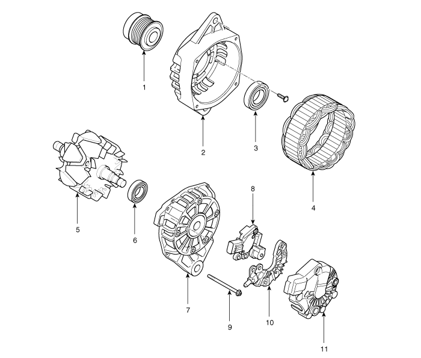

# Kia Sportage SL: Motorização NU / Alternator Components and Components Location

[Home](../../index.md) / [Kia Sportage SL Service & Repair Manual](../sportage-482.md) / [Motorização NU](index.md) / Alternator Components and Components Location

## Componentes

| 1. OAD (Decuplador Alternador de Sobrecarga) 2. Bracket Frente 3. Rolamento Frente 4. Estator 5. Rotor 6. Rolamento Traseiro | 7. Bracket Traseiro 8. Assembléia de Suporte das Escovas 9. Parafuso Transversal 10. Assembléia de Rectificador 11. Cobertura Traseira |
| --- | --- |
