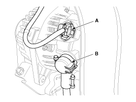
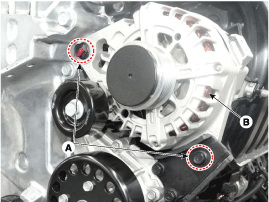

# Kia Sportage SL: Motorização NU / Alternator Repair procedures

[Home](../../index.md) / [Kia Sportage SL Service & Repair Manual](../sportage-482.md) / [Motorização NU](index.md) / Alternator Repair procedures

## Remoção

1. Desligue o interruptor de ignição e desconecte o cabo negativo (-) da bateria.

2. Remova a correia de transmissão.

   (Consulte o Sistema Mecânico do Motor - "Correia de Transmissão")

3. Desconecte o conectador (A) e o cabo (B) do terminal "B" do alternador.

   

4. Remova o alternador (B) após desafinar os parafusos de montagem (A).

   

## Instalação

1. Instale na ordem inversa da remoção.

2. Ajuste a tensão da correia do alternador após a instalação.

   (Consulte o Sistema Mecânico do Motor - "Correia de Transmissão")

   ```
   Parafuso de instalação do alternador :
   [12mm (0,47 polegadas) parafuso]
   19,6 ~ 26,5 N.m (2,0 ~ 2,7 kgf.m, 14,5 ~ 19,5 lb-ft)
   [14mm (0,55 polegadas) parafuso]
   29,4 ~ 41,2 N.m (3,0 ~ 4,2 kgf.m, 21,7 ~ 30,4 lb-ft)
   ```
