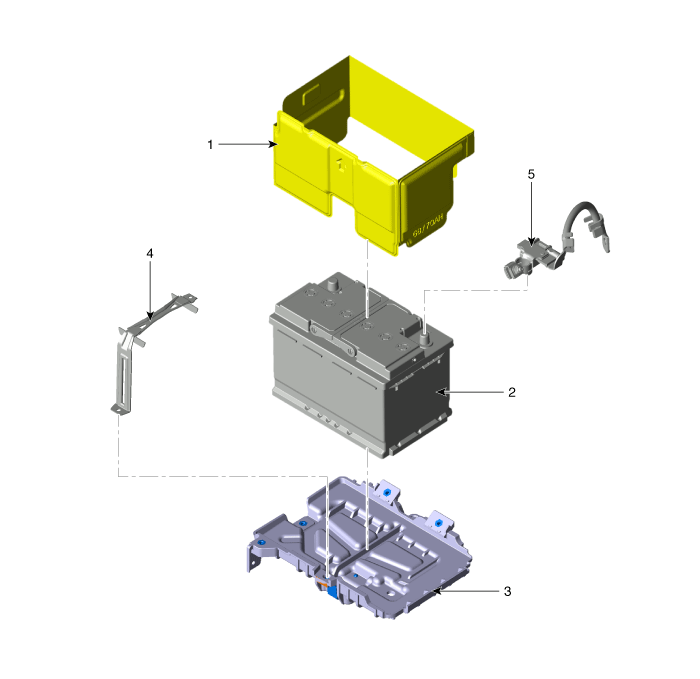

# Kia Sportage SL: Motorização NU / Battery Components and Components Location

[Home](../../index.md) / [Kia Sportage SL Service & Repair Manual](../sportage-482.md) / [Motorização NU](index.md) / Battery Components and Components Location

## Componentes

| 1. Isolador da Bateria 2. Bateria AMG 3. Chassi da Bateria | 4. Suporte de Montagem da Bateria 5. Sensor da Bateria |
| --- | --- |
