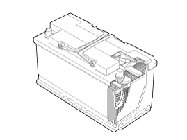

# Bateria — descrição e operação

[Home](../../index.md) / [Manual de Serviço e Reparo](../sportage-482.md) / [Motorização NU](index.md) / Bateria — descrição e operação

## Descrição

[AGM Bateria]

A bateria AGM é utilizada para cargas especialmente pesadas na rede do veículo, dependendo do equipamento e das exigências. AGM significa Bateria de Material de Vidro Absorvente; é uma fina toalha de fibra de vidro absorvente. As baterias AGM são instaladas em modelos com cargas elétricas/consomidores que têm uma alta demanda energética.

A constante demanda energética crescente dos sistemas elétricos modernos dos veículos exige soluções de bateria cada vez mais poderosas.

A consumo de energia é significativo mesmo quando o veículo está estacionado.

O preço ligeiramente superior em comparação com uma bateria de tamanho similar é totalmente compensado pelos seguintes benefícios:

| - | Vida útil significativamente maior |
| --- | --- |

| - | Maior confiabilidade de partida em baixas temperaturas |
| --- | --- |

| - | 100% de liberdade de manutenção |
| --- | --- |

| - | Baixo risco em caso de acidente (reduzido risco ao meio ambiente) |
| --- | --- |

