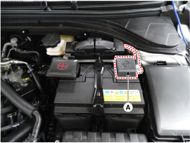
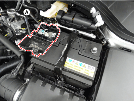
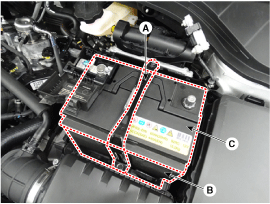
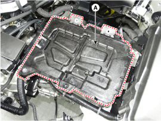
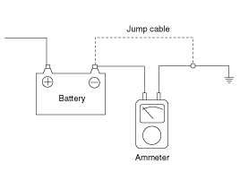

# Bateria — procedimentos

[Home](../../index.md) / [Manual de Serviço e Reparo](../sportage-482.md) / [Motorização NU](index.md) / Bateria — procedimentos

## Remoção

Bateria

1. Desligue o interruptor de ignição.

2. Desconecte o terminal (-) da bateria (A).

   

3. Remova o terminal (+) da bateria (B).

   

4. Remova o suporte de montagem da bateria (A).

5. Remova a placa de isolamento da bateria após remover a bateria (B).

   

Bandeja da Bateria

1. Remova a bateria.

   (Consulte "Remoção")

2. Remova a montagem do filtro de ar.

   (Consulte Sistema Mecânico do Motor - "Filtro de Ar")

3. Remova o ECM.

   (Consulte Sistema de Controle do Motor / Sistema de Combustível - "Módulo de Controle do Motor (ECM)")

4. Remova a bandeja da bateria (A) após soltar as varetas.

   

## Instalação

1. Instale na ordem inversa da remoção.

   ```
   Instalação do terminal (-) da bateria:
   7,8 ~ 9,8 N.m (0,8 ~ 1,0 kgf.m, 5,8 ~ 7,2 lb-ft)
   Instalação do terminal (+) da bateria:
   7,8 ~ 9,8 N.m (0,8 ~ 1,0 kgf.m, 5,8 ~ 7,2 lb-ft)
   Instalação do suporte de montagem da bateria e da placa de isolamento:
   19,6 ~ 29,4 N.m (2,0 ~ 3,0 kgf.m, 14,5 ~ 30,4 lb-ft)
   ```

   > **Nota**
   >
   > - Ao instalar a bateria, fixe corretamente o suporte de montagem na bandeja.

### Carregamento de bateria AGM

A bateria AGM deve ser carregada com tensão constante ou
tensão constante corrente-tensão constante para minimizar a degradação de desempenho
devido ao carregamento.

Se a bateria for carregada com corrente constante, pode ocorrer um carregamento excessivo. Isso pode causar danos ao interior da bateria e terá um
efeito adverso na vida útil da bateria.

> **Nota**
   >
   > - Não carregue com mais de 14,8V ou em modo de carregamento rápido.

### Condições de carregamento com tensão constante

```
Tensão de carregamento / tempo:
14,7V [68°F ~ 86°F (20°C ~ 30°C)] / aproximadamente 24 horas
A tensão de carregamento mínima:
14,4V [68°F ~ 86°F (20°C ~ 30°C)]
A tensão de carregamento máxima:
14,8V [68°F ~ 86°F (20°C ~ 30°C)]
```

| • A temperatura da bateria deve ser mantida em torno de 68°F ~ 86°F (20°C ~ 30°C) durante o carregamento da bateria. |  |
| --- | --- |
| • | A temperatura da bateria deve ser mantida em torno de 68°F ~ 86°F (20°C ~ 30°C) durante o carregamento da bateria. |

> **Cautela**
   >
   > - Se a bateria for carregada diretamente nos terminais da bateria em veículos com sensor de bateria, podem ocorrer interpretações incorretas do estado da bateria e, em certos casos, também mensagens de controle de verificação ou memória de falha inteira podem ocorrer.
   > - Após o término do recarregamento, deixe a bateria descansar por mais de 10 horas em temperatura normal para a estabilização da bateria.

## Limpeza

1. Certifique-se de que o interruptor de ignição e todos os acessórios estejam na posição OFF.

2. Desconecte as barras negativas da bateria (A).

3. Remova a bateria do veículo.

   (Consulte o Sistema de Carregamento - "Bateria")

   > **Cuidado**
   >
   > - Cuidado deve ser tomado no caso de a caixa da bateria estar rachada ou vazando, para proteger a pele do eletrolito.
   > - Deve-se usar luvas de borracha pesada (não as do tipo doméstico) ao remover a bateria.

4. Inspeção da prateleira da bateria para danos causados pela perda de eletrolito. Se houver danos ácidos, será necessário limpar a área com uma solução de água quente limpa e bicarbonato de sódio. Esfregue a área com um pincel rígido e enxágue com um pano umedecido com bicarbonato de sódio e água.

5. Limpe o topo da bateria com a mesma solução descrita acima.

6. Inspeção da caixa e do capô da bateria para rachaduras. Se houver rachaduras, a bateria deve ser substituída.

7. Limpe as postas da bateria com uma ferramenta adequada para limpeza de postas de bateria.

8. Limpe a superfície interna dos conectores do terminal com uma ferramenta adequada para limpeza de bateria. Substitua as cables danificadas ou esgarrafadas e os conectores do terminal quebrados.

9. Instale a bateria no veículo.

10. Conecte as terminais das barras à posta da bateria, garantindo que as partes superiores das terminais estejam alinhadas com as partes superiores das postas.

11. Aperte os parafusos das terminais firmemente.

12. Aplicar uma fina camada de graxa mineral nas conexões após a fixação.

   > **Cuidado**
   >
   > - Quando as baterias estão sendo carregadas, um gás explosivo se forma sob o cobre de cada célula. Não fume perto de baterias sendo carregadas ou que tenham sido recentemente carregadas. Não interrompa o circuito vivo nas terminais das baterias sendo carregadas.
   > - Uma chama ocorrerá quando o circuito for interrompido. Mantenha chamas abertas longe da bateria.

## Inspeção da corrente parasita do veículo

1. Desligue todos os dispositivos elétricos, e então desligue o interruptor de ignição.

2. Feche todas as portas, exceto a do capô, e então trave todas as portas.

   (1) Desconecte o conector do interruptor do capô.

   (2) Feche o porta-malas.

   (3) Feche as portas ou remova os interruptores das portas.

3. Aguarde alguns minutos até que os sistemas elétricos do veículo entrem em modo de sono.

   > **Nota**
   >
   > - Para uma medição precisa da corrente parasita do veículo, todos os sistemas elétricos devem entrar em modo de sono. (Isso leva pelo menos uma hora ou no máximo um dia.) No entanto, uma medição aproximada da corrente parasita do veículo pode ser feita após 10~20 minutos.

4. Conecte um amperímetro em série entre o terminal (-) da bateria e o cabo de terra, e então desconecte o suporte do cabo de terra do terminal (-) da bateria lentamente.

   > **Nota**
   >
   > - Cuide para que os fios do amperímetro não se desliguem do terminal (-) da bateria e do cabo de terra para prevenir a redefinição da bateria. Em caso de redefinição da bateria, conecte novamente o cabo da bateria, e então ligue o motor ou acione o interruptor de ignição por mais de 10 segundos. Repita o procedimento a partir do item 1.
   > - Para prevenir a redefinição da bateria durante a inspeção,
   > - Conecte um cabo de salto entre o terminal (-) da bateria e o cabo de terra.
   > - Desconecte o cabo de terra do terminal (-) da bateria.
   > - Conecte um amperímetro entre o terminal (-) da bateria e o cabo de terra.
   > - Após desconectar o cabo de salto, leia o valor da corrente do amperímetro.

   

5. Leia o valor da corrente do amperímetro.

   A. Se a corrente parasita estiver acima do valor limite, procure por circuitos anormais removendo um fusível de cada vez e verificando a corrente parasita.

   B. Reconecte apenas o fusível suspeito de corrente parasita e procure pelo componente suspeito removendo um componente conectado ao circuito de cada vez até que a corrente parasita caia abaixo do valor limite.

   ```
   Valor limite (após 10 ~ 20 minutos): Abaixo de 50 mA
   ```
