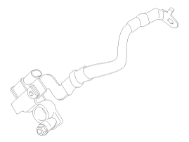

# Kia Sportage SL: Motorização NU / Battery Sensor Description and Operation

[Home](../../index.md) / [Kia Sportage SL Service & Repair Manual](../sportage-482.md) / [Motorização NU](index.md) / Battery Sensor Description and Operation

## Descrição

Os veículos têm muitos controladores que usam mais eletricidade.
Estes controladores controlam seus próprios sistemas com base em informações de diversos
sensores. É importante ter um fornecimento de energia estável, pois há diversos
sensores fornecendo uma variedade de informações. O sensor de bateria está montado no terminal (-) da bateria. Ele transmite a tensão da bateria, a corrente e a informação de temperatura para o ECM. O ECM controla a tensão gerada com base no ciclo de duty cycle desses sinais.

