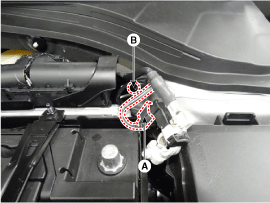

# Sensor da bateria — procedimentos

[Home](../../index.md) / [Manual de Serviço e Reparo](../sportage-482.md) / [Motorização NU](index.md) / Sensor da bateria — procedimentos

## Remoção

1. Desconecte o cabo negativo (-) da bateria.

2. Desconecte o conector do sensor da bateria (A).

3. Remova o cabo negativo (-) da bateria após remover os parafusos (B).

   

## Instalação

1. Instale na ordem inversa da remoção.

   ```
   Fixação do cabo do sensor da bateria:
   10,8 ~ 13,7 N.m (1,1 ~ 1,4 kgf.m, 8,0 ~ 10,1 lb-ft)
   Fixação do parafuso do terminal negativo (-) da bateria:
   3,9 ~ 5,9 N.m (0,4 ~ 0,6 kgf.m, 2,9 ~ 4,3 lb-ft)
   ```
