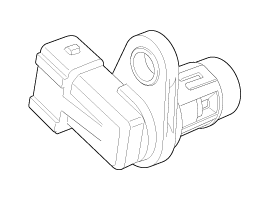

# Kia Sportage SL: Motorização NU / Camshaft Position Sensor (CMPS) Description and Operation

[Home](../../index.md) / [Kia Sportage SL Service & Repair Manual](../sportage-482.md) / [Motorização NU](index.md) / Camshaft Position Sensor (CMPS) Description and Operation

## Descrição

Sensor de Posição do Timão (CMPS) é um sensor hall que detecta a posição do timão usando um elemento hall.

Ele está relacionado com o Sensor de Posição do Timão (CKPS) e detecta a posição do pistão de cada cilindro que o CKPS não pode detectar.

O CMPS está instalado na cobertura do motor e utiliza um disco-alvo instalado no timão. O Sensor de Posição do Timão é um sensor de efeito hall. À medida que o disco-alvo passa pelo sensor hall, o campo magnético no sensor muda. O sensor então troca um sinal que cria uma onda quadrada.

