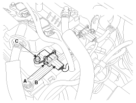
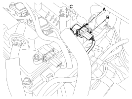

# Sensor CMPS (posição do comando) — procedimentos

[Home](../../index.md) / [Manual de Serviço e Reparo](../sportage-482.md) / [Motorização NU](index.md) / Sensor CMPS (posição do comando) — procedimentos

## Inspeção

1. Verifique a onda de sinal do CMPS e do CKPS usando o GDS.

   ```
   Especificação : Consulte "Onda de Sinal"
   ```

## Remoção

> **Aviso**
>
> - NÃO remova o sensor de posição do comando de válvulas durante a operação do motor ou imediatamente após a parada do motor, ou ocorrerá uma queimadura pelo óleo do motor que escorre.

### Banho 1 / Intalação

1. Desligue o interruptor de ignição e desconecte o cabo negativo (-) da bateria.

2. Desconecte o conectador do sensor de posição do comando de válvulas (B) após remover o gancho (A).

3. Remova a viga de fixação (C), e então remova o sensor.

   

### Banho 1 / Exaustão

1. Desligue o interruptor de ignição e desconecte o cabo negativo (-) da bateria.

2. Desconecte o conectador do sensor de posição do comando de válvulas (B) após remover o gancho (A).

3. Remova a viga de fixação (C), e então remova o sensor.

   

## Instalação

> **Cautela**
>
> - Instale o componente com as torques especificadas.
> - Tenha cuidado com danos internos quando o componente cair. Neste caso, utilize após inspeção.

> **Cautela**
>
> - Aplicar óleo do motor no anel de vedação.

> **Cautela**
>
> - Insira o sensor no orifício de instalação com cuidado para não danificar.

> **Cautela**
>
> - Tenha cuidado com danos ao corpo do sensor e ao conectador.
> - Tenha cuidado com danos ao anel de vedação.

1. A instalação é o inverso da remoção.

   ```
   Torque do parafuso de instalação do sensor de posição do comando de válvulas :
   9,8 ~ 11,8 N.m (1,0 ~ 1,2 kgf.m, 7,2 ~ 8,7 lb-ft)
   ```
