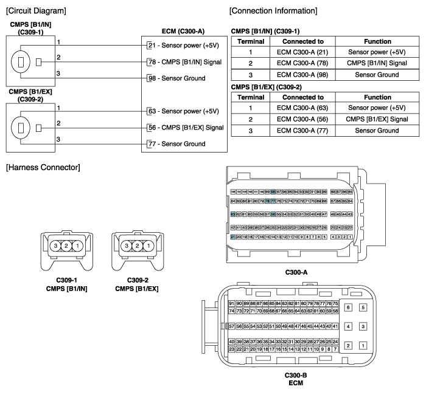

# Sensor CMPS (posição do comando) — diagramas esquemáticos

[Home](../../index.md) / [Manual de Serviço e Reparo](../sportage-482.md) / [Motorização NU](index.md) / Sensor CMPS (posição do comando) — diagramas esquemáticos

## Diagrama Elétrico

