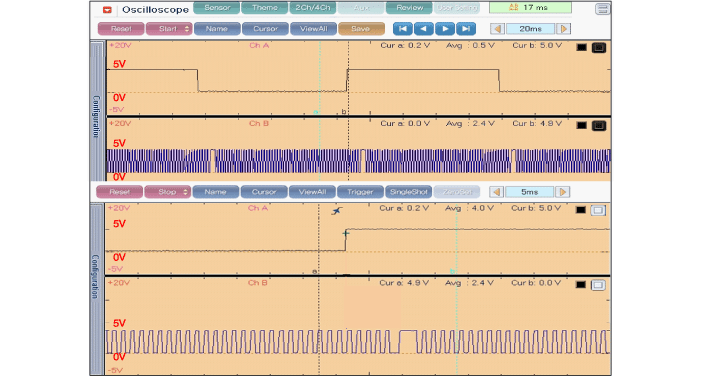

# Sensor CMPS (posição do comando) — diagnóstico

[Home](../../index.md) / [Manual de Serviço e Reparo](../sportage-482.md) / [Motorização NU](index.md) / Sensor CMPS (posição do comando) — diagnóstico

## Forma de Onda

