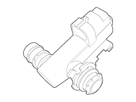

# Válvula de fechamento do cânister (CCV) — descrição e operação

[Home](../../index.md) / [Manual de Serviço e Reparo](../sportage-482.md) / [Motorização NU](index.md) / Válvula de fechamento do cânister (CCV) — descrição e operação

## Descrição

A Valvula de Fechamento do Canister (CCV) está normalmente aberta e é instalada
na linha de ventilação do canister. Ela selará o sistema de controle de emissões evaporativas
fechando o canister do ar atmosférico durante o processo de detecção de vazamento EVAP.

