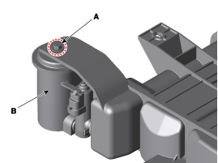
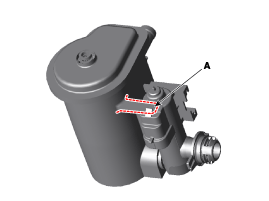
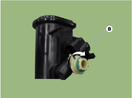

# Kia Sportage SL: Motorização NU / Canister Close Valve (CCV) Repair procedures

[Home](../../index.md) / [Kia Sportage SL Service & Repair Manual](../sportage-482.md) / [Motorização NU](index.md) / Canister Close Valve (CCV) Repair procedures

## Inspeção

1. Desligue o interruptor de ignição.

2. Desconecte o conector do CCV.

3. Mede a resistência entre o terminal 1 e 2 do CCV.

4. Verifique se a resistência está dentro da especificação.

   ```
   Especificação : Consulte "Especificação"
   ```

5. Desconecte a mangueira de vapor conectada ao canister do CCV.

6. Conecte um pump de vácuo ao bico.

7. Tercele o cabo de controle do CCV e aplique tensão da bateria à linha de alimentação do CCV.

8. Aplique vácuo e verifique a operação da válvula.

   ```
   Especificação : Vácuo mantido
   ```

## Remoção

1. Desligue o interruptor de ignição e desconecte o terminal negativo (-) da bateria.

2. Remova a montagem do canister.

   (Consulte o Sistema de Emissão - "Canister")

3. Remova o parafuso de instalação (A) e, em seguida, remova o filtro de ar (B).

   

4. Libere o lembrete (A), e, em seguida, separe a valvula de fechamento do canister (B) do filtro de ar do tanque de combustível girando-a na direção do seta na figura.

   

   

5. Instale um novo filtro de ar do tanque de combustível de acordo com o contrário do procedimento de remoção.

## Instalação

> **Cuidado**
>
> - Instale o componente com as torques especificadas.
> - Tenha em mente que danos internos podem ocorrer quando o componente cair. Neste caso, use após verificar.

1. A instalação é o contrário da remoção.
