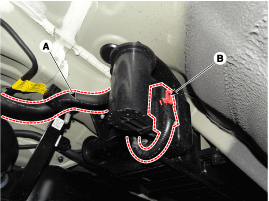
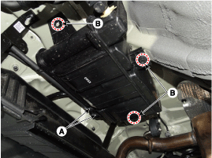
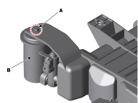
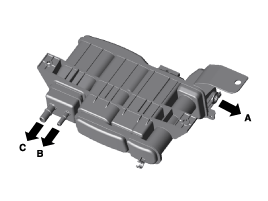

# Cânister — procedimentos

[Home](../../index.md) / [Manual de Serviço e Reparo](../sportage-482.md) / [Motorização NU](index.md) / Cânister — procedimentos

## Remoção

1. Desligue a ignição e desconecte o cabo negativo (-) da bateria.

2. Levante o veículo.

3. Desconecte o hose de ventilação (A) e o conectador do extensor da válvula de fechamento do cânister (B).

   

4. Desconecte o quick-connector do tubo de vapor (A).

5. Remova as engrenagens de instalação e o parafuso (B) e, em seguida, remova a montagem do cânister.

   

6. Remova o parafuso de instalação (A), e, em seguida, remova o filtro de ar (B).

   

## Inspeção

1. Verifique os seguintes itens visualmente.

   A. Fendas ou vazamentos no cânister

   B. Conexões soltas, distorções ou danos no hose/tubo de vapor

   

   A: Cânister - Atmosfera

   B: Cânister - Manifold de Admissão

   C: Cânister - Tanque de Combustível

## Instalação

1. A instalação é o inverso da remoção.

   ```
   Parafuso/engrenagem de instalação do cânister :
   19,6 ~ 29,4 N.m (2,0 ~ 3,0 kgf.m, 14,5 ~ 21,7 lb-ft)
   ```
