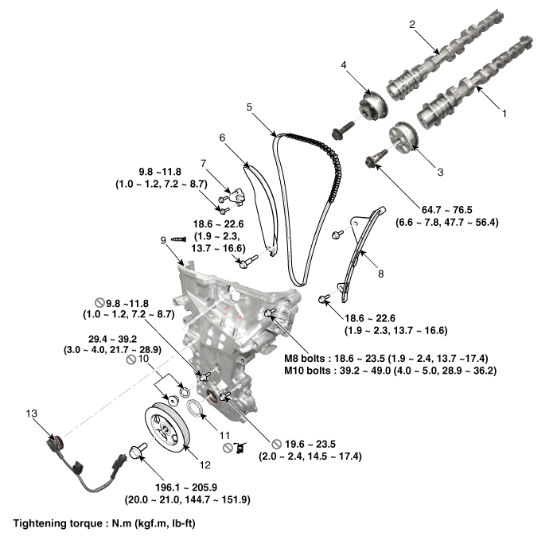

# Kia Sportage SL: Motorização NU / Components and Components Location

[Home](../../index.md) / [Kia Sportage SL Service & Repair Manual](../sportage-482.md) / [Motorização NU](index.md) / Components and Components Location

## Componentes

| 1. Cilindro de admissão 2. Cilindro de escape 3. Assembléia de CVVT de admissão 4. Assembléia de CVVT de escape 5. Cadeia de alinhamento 6. Braço de tensão da cadeia de alinhamento 7. Mecanismo de tensão da cadeia de alinhamento | 8. Guiador da cadeia de alinhamento 9. Cobertura da cadeia de alinhamento 10. Parafuso e selo de plugue de serviço 11. Selo de óleo da frente 12. Pulley do amortecedor do braço do motor 13. Atuador de CVVT de bloqueio intermediário |
