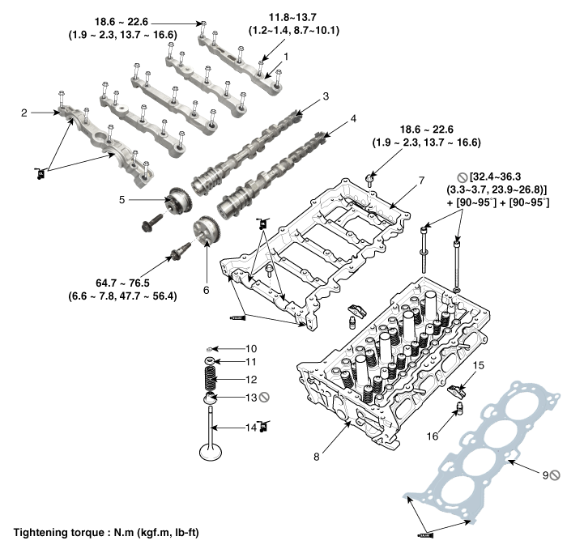

# Componentes e localização

[Home](../../index.md) / [Manual de Serviço e Reparo](../sportage-482.md) / [Motorização NU](index.md) / Componentes e localização

## Componentes

| 1. Tampa do eixo dos cames 2. Tampa de suporte do eixo dos cames frontal 3. Eixo dos cames de escape 4. Eixo dos cames de admissão 5. Montagem de CVVT de escape 6. Montagem de CVVT de admissão | 7. Carrinho de cames 8. Bloco de cilindros 9. Selo de gasketagem do bloco de cilindros 10. Bloco de retenção 11. Retenção 12. Amortecedor de mola da válvula  | 13. Selo do estilete da válvula 14. Válvula 15. Braço de balança 16. Ajustador mecânico da folga (AEC) |
