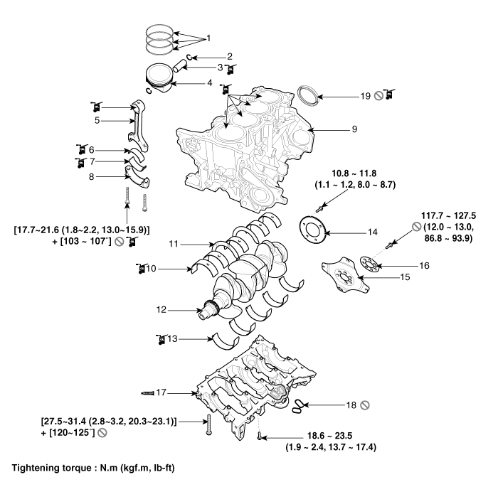

# Kia Sportage SL: Motorização NU / Components and Components Location

[Home](../../index.md) / [Kia Sportage SL Service & Repair Manual](../sportage-482.md) / [Motorização NU](index.md) / Components and Components Location

## Componentes

| 1. Anel de pistão 2. Anel de engate 3. Pincoleta 4. Pistão 5. Conectador 6. Conector superior 7. Conector inferior | 8. Conector superior 9. Bloco de cilindros 10. Suporte superior do eixo curvo 11. Suporte de deslizamento do eixo curvo 12. Eixo curvo 13. Suporte inferior do eixo curvo 14. Disco sensor de posição do eixo curvo (CKPS) | 15. Disco de transmissão 16. Placa adaptadora 17. Caixa inferior do eixo curvo 18. Afloramento 19. Selo traseiro |
