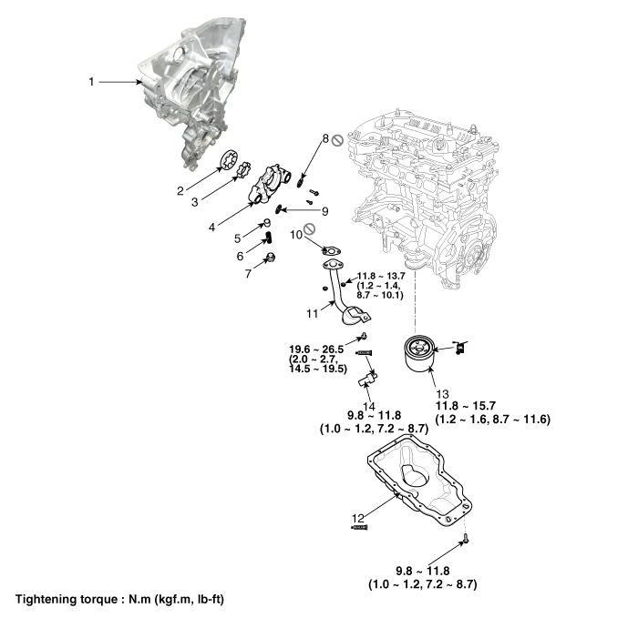

# Kia Sportage SL: Motorização NU / Components and Components Location

[Home](../../index.md) / [Kia Sportage SL Service & Repair Manual](../sportage-482.md) / [Motorização NU](index.md) / Components and Components Location

## Componentes

| 1. Cobertura da corrente de sincronização 2. Rolamento externo 3. Rolamento interno 4. Cobertura do bomba de óleo 5. Plunger de alívio 6. Mola de alívio 7. Fita de alívio | 8. Aro elástico (lado de sucção) 9. Aro elástico (lado de descarga) 10. Gasket da grade de óleo 11. Grade de óleo 12. Pan de óleo 13. Filtro de óleo 14. Interruptor de pressão de óleo (OPS) |
| --- | --- |
