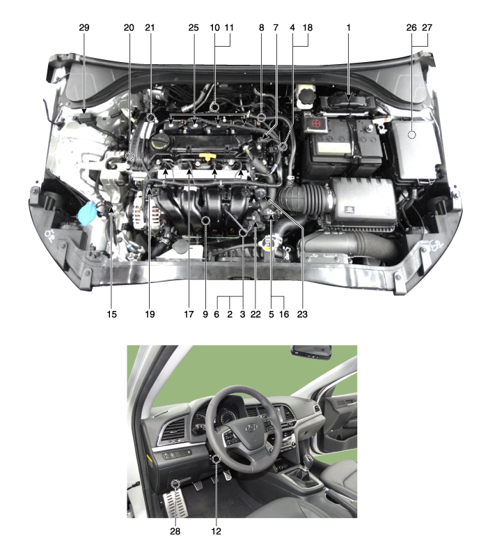
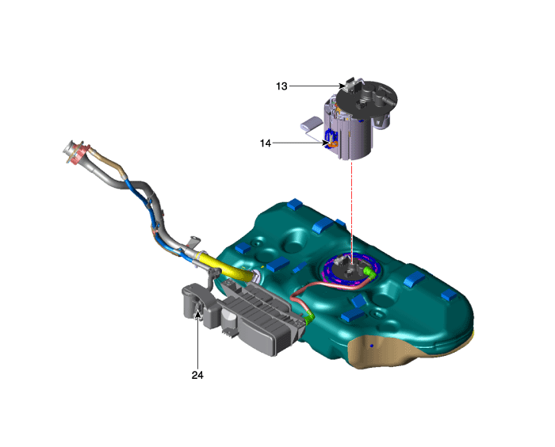

# Componentes e localização

[Home](../../index.md) / [Manual de Serviço e Reparo](../sportage-482.md) / [Motorização NU](index.md) / Componentes e localização

## Localização dos Componentes

| 1. Módulo de Controle do Motor (ECM) 2. Sensor de Pressão do Manifold Absoluto (MAPS) 3. Sensor de Temperatura do Ar Intalado (IATS) 4. Sensor de Temperatura do Coolante do Motor (ECTS) 5. Sensor de Posição do Acelerador (TPS) [integrado no Módulo ETC] 6. Sensor de Posição do Crankshaft (CKPS) 7. Sensor de Posição do Camshaft (CMPS) [Cilindro 1 / Intalado] 8. Sensor de Posição do Camshaft (CMPS) [Cilindro 1 / Exaustão] 9. Sensor de Chacoalhada (KS) 10. Sensor de Oxigênio Quente (HO2S) [Cilindro 1 / Sensor 1] 11. Sensor de Oxigênio Quente (HO2S) [Cilindro 1 / Sensor 2] 12. Sensor de Posição do Acelerador (APS) 13. Sensor de Pressão do Tanque de Combustível (FTPS) 14. Sensor de Nível do Tanque de Combustível (FLS) 15. Transdutor de Pressão do Sistema de Ar Condicionado (APT) | 16. Motor do ETC [integrado no Módulo ETC] 17. Injetor 18. Válvula de Controle do Sistema de Purga (PCSV) 19. Válvula de Controle do Óleo do CVVT (OCV) [Cilindro 1 / Intalado] #1 20. Válvula de Controle do Óleo do CVVT (OCV) [Cilindro 1 / Intalado] #2 21. Válvula de Controle do Óleo do CVVT (OCV) [Cilindro 1 / Exaustão] 22. Válvula do Solenoide de Intalação Variável (VIS) 23. Atuador de Movimento de Carga Variável (VCMA) 24. Válvula de Fechamento do Canister (CCV) 25. Bobina de Ignição 26. Relé Principal 27. Relé do Bomba de Combustível 28. Conector de Linha de Dados (DLC) [16-pin] 29. Conector Multifuncional de Verificação [20-pin] |
| --- | --- |

| 1. Módulo de Controle do Motor (ECM) | 2. Sensor de Pressão do Manifold Absoluto (MAPS) 3. Sensor de Temperatura do Ar Intalado (IATS) |
| --- | --- |
| 4. Sensor de Temperatura do Coolante do Motor (ECTS) | 5. Sensor de Posição do Acelerador (TPS) 16. Motor do ETC |
| 6. Sensor de Posição do Crankshaft (CKPS) | 7. Sensor de Posição do Camshaft (CMPS) [Cilindro 1 / Intalado] 8. Sensor de Posição do Camshaft (CMPS) [Cilindro 1 / Exaustão] |
| 9. Sensor de Chacoalhada (KS) | 10. Sensor de Oxigênio Quente (HO2S) [Cilindro 1 / Sensor 1] |
| 11. Sensor de Oxigênio Quente (HO2S) [Cilindro 1 / Sensor 2] | 12. Sensor de Posição do Acelerador (APS) |
| 13. Sensor de Pressão do Tanque de Combustível (FTPS) | 14. Sensor de Nível do Tanque de Combustível (FLS) |
| 15. Transdutor de Pressão do Sistema de Ar Condicionado (APT) | 17. Injetor 25. Bobina de Ignição |
| 18. Válvula de Controle do Sistema de Purga (PCSV) | 19. Válvula de Controle do Óleo do CVVT (OCV) [Cilindro 1 / Intalado] #1 |
| 20. Válvula de Controle do Óleo do CVVT (OCV) [Cilindro 1 / Intalado] #2 | 21. Válvula de Controle do Óleo do CVVT (OCV) [Cilindro 1 / Exaustão] |
| 22. Válvula do Solenoide de Intalação Variável (VIS) | 23. Atuador de Movimento de Carga Variável (VCMA) |
| 24. Válvula de Fechamento do Canister (CCV) | 26. Relé Principal 27. Relé do Bomba de Combustível |
| 28. Conector de Linha de Dados (DLC) [16-pin] | 29. Conector Multifuncional de Verificação [20-pin] |
